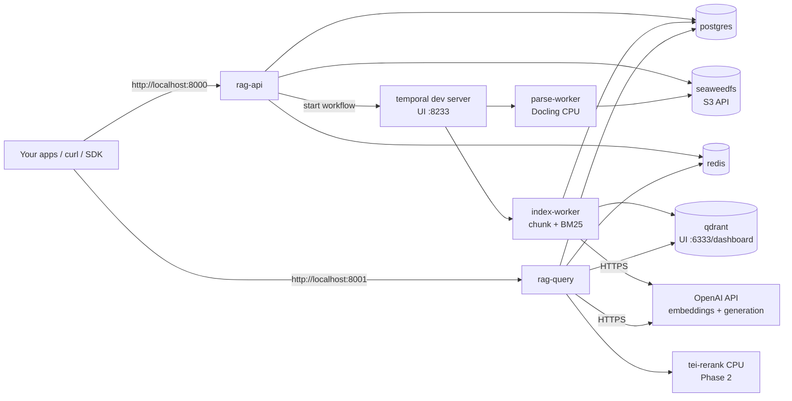
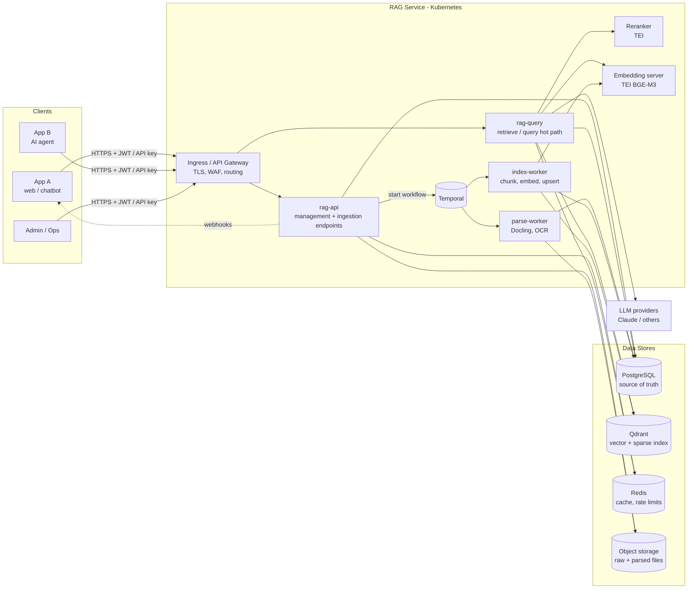
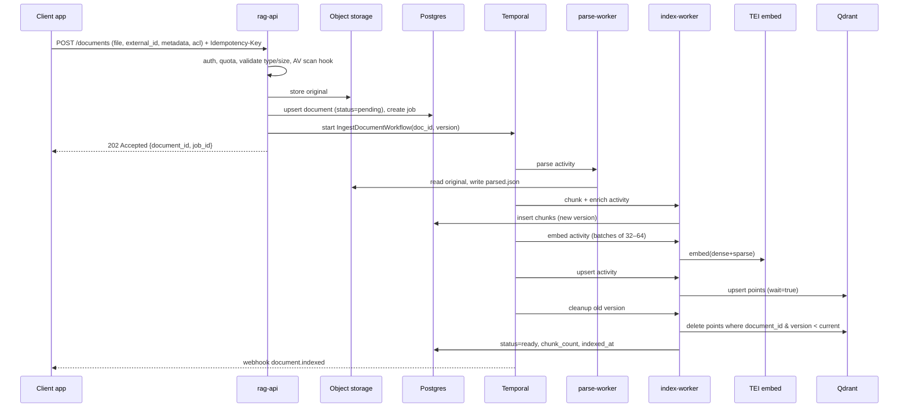
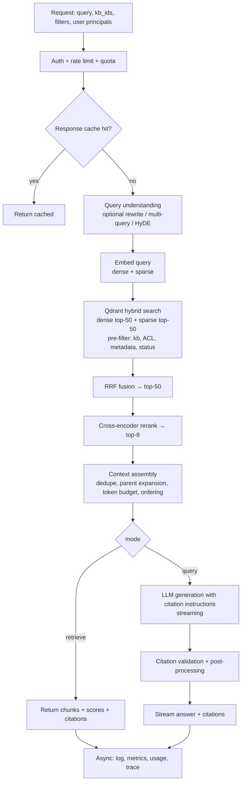

# Enterprise RAG Service — Architecture & Implementation Plan

| | |
|---|---|
| **Status** | Draft v1.1 — design plan, no code yet. **V1 runs locally (Docker Compose) with OpenAI models** — see §0 |
| **Date** | 2026-11-01 |
| **Owner** | Gurpiyar Singh |
| **Goal** | A production-grade, horizontally scalable Retrieval-Augmented Generation (RAG) platform for a single organization, exposed as an independent service that any application can consume over a versioned API. |

---

## Table of Contents

0. [V1 Scope — Local Deployment + OpenAI](#0-v1-scope--local-deployment--openai)
1. [Goals, Non-Goals & Requirements](#1-goals-non-goals--requirements)
2. [Key Decisions at a Glance](#2-key-decisions-at-a-glance)
3. [High-Level Architecture](#3-high-level-architecture)
4. [Service Decomposition](#4-service-decomposition)
5. [Data Stores — Choice & Reasoning](#5-data-stores--choice--reasoning)
6. [Data Model](#6-data-model)
7. [Ingestion Pipeline](#7-ingestion-pipeline)
8. [Retrieval & Generation Pipeline](#8-retrieval--generation-pipeline)
9. [Model Layer (Embeddings, Reranker, LLM)](#9-model-layer-embeddings-reranker-llm)
10. [Public API Design](#10-public-api-design)
11. [Access Control](#11-access-control)
12. [Security](#12-security)
13. [Scalability & Performance](#13-scalability--performance)
14. [Reliability & Disaster Recovery](#14-reliability--disaster-recovery)
15. [Observability](#15-observability)
16. [Evaluation & Quality](#16-evaluation--quality)
17. [Deployment & Infrastructure](#17-deployment--infrastructure)
18. [CI/CD](#18-cicd)
19. [Tech Stack & Libraries](#19-tech-stack--libraries)
20. [Repository Structure](#20-repository-structure)
21. [Extensibility (Plugin Interfaces)](#21-extensibility-plugin-interfaces)
22. [Cost Management](#22-cost-management)
23. [Testing Strategy](#23-testing-strategy)
24. [Phased Roadmap](#24-phased-roadmap)
25. [Risks & Mitigations](#25-risks--mitigations)
26. [Open Questions](#26-open-questions)

---

## 0. V1 Scope — Local Deployment + OpenAI

The rest of this document describes the **target architecture**. V1 has two constraints:

1. **No cloud deployment yet** — V1 runs on a single machine with **Docker Compose** (Docker Desktop + WSL2 on Windows).
2. **OpenAI is the model provider for V1** — embeddings and generation both use the OpenAI API with one server-side key.

The guiding rule for V1: **simplify the infrastructure, not the architecture.** The service boundaries, data model, API contract, access control, provider interfaces and Temporal workflows stay exactly as designed. Only the *deployment target* and the *provider implementations* change. *Why:* moving to Kubernetes later, or switching to Claude / self-hosted BGE-M3, then becomes a config + deployment change, not a rewrite. The expensive things to retrofit (API-client access control, idempotency, versioned collections, the API contract) are built in from day one. The cheap things to add later (Kubernetes, Terraform, GPUs, managed DBs) are deferred.

### 0.1 What changes in V1 vs. the target design

| Area | Target (§2 onward) | **V1 (local)** | Why for V1 |
|---|---|---|---|
| Deployment | Kubernetes + Helm + Terraform + Argo CD | **Docker Compose** on one machine | No cloud yet; Compose runs every component with one command and uses the same images Kubernetes will run later. |
| Dense embeddings | BGE-M3 on TEI (GPU) | **OpenAI `text-embedding-3-large` with `dimensions=1024`** | No local GPU needed. `-3-large` retrieves noticeably better than `-3-small`; Matryoshka-style truncation to 1024 dims keeps vector RAM/storage the same as the target design at nearly full quality. Cost is low (~$0.13 per 1M tokens → a 1M-chunk corpus of ~500 tokens each ≈ $65 one-time). |
| Sparse / keyword vectors | BGE-M3 sparse output | **BM25 sparse vectors computed locally with `fastembed` (`Qdrant/bm25`)** + Qdrant IDF modifier | OpenAI embeddings are dense only. BM25 is a tokenizer + stemmer with no neural model, so it runs on CPU in microseconds inside the worker/query process. Hybrid search stays the same as in the target design. |
| Reranker | bge-reranker-v2-m3 on TEI (GPU) | **TEI CPU image serving `cross-encoder/ms-marco-MiniLM-L-6-v2`** (rerank top-30) — added in Phase 2 | A ~22M-parameter cross-encoder reranks 30 candidates in ~100–200 ms on CPU. The larger multilingual reranker is too slow on CPU. Swap to `bge-reranker-v2-m3` once a GPU is available or if content is multilingual. Because it's behind the `Reranker` interface, it's a config change. |
| LLM — answers | Claude Sonnet | **OpenAI `gpt-4o`** (chosen for V1, 2026-11-01) — model name in config (`RAG_LLM_MODEL`) | Strong instruction following and citation behavior, and no reasoning-token delay before the first token, so time-to-first-token stays low. Reasoning models (gpt-5 family) can be switched in later through config (`RAG_LLM_REASONING_EFFORT`). |
| LLM — utility (query rewrite, contextual headers, judge) | Claude Haiku | **OpenAI `gpt-4o-mini`** (config) | These tasks are high-volume and simple, so the cheapest capable model fits. |
| Auth | OIDC/JWT + API keys | **API keys only** (+ a bootstrap admin key from `.env`) | No identity provider is needed for local use. The JWT path is added when deploying for real users (Phase 4). |
| PostgreSQL | Managed service, HA, replicas | **Your existing local PostgreSQL 18.6** (Windows service, port 5432), reached from containers via `host.docker.internal`. See §0.8 | It's already installed and running, and it's newer than the planned minimum (16), so no second Postgres installation is needed. |
| Redis / Qdrant / S3 | Managed services, HA, replicas | **Single containers with named Docker volumes**; SeaweedFS for S3 (MinIO no longer publishes community images, ADR 0008) | Same software and wire protocols. Only the HA topology differs, and the app code doesn't depend on it. |
| Temporal | Temporal Cloud / Helm | **Temporal dev server container** (`temporal server start-dev`, SQLite-backed, with UI) | Keeps durable, resumable workflows from day one in one lightweight container. Replacing Temporal with ad-hoc background tasks now would mean rewriting ingestion later. |
| Observability | OTel → Prometheus/Grafana/Loki/Tempo + Langfuse | **Structured JSON logs + `/metrics` endpoint by default; Langfuse and Grafana stack as opt-in Compose profiles** | Langfuse v3 needs its own Postgres, ClickHouse, Redis and MinIO, which is heavy for a laptop. It stays available when you want to debug RAG traces, but isn't always running. |
| Security extras (WAF, mesh mTLS, KMS, BYOK) | Enabled | **Deferred**; secrets in a git-ignored `.env` | Not meaningful on a single local machine. The app-level controls still apply (KB access checks, ACL filters, input validation, SSRF guards, prompt-injection framing). |

### 0.2 V1 local topology



### 0.3 Docker Compose services (V1)

| Service | Image | Host port | Notes |
|---|---|---|---|
| *(none — host Postgres)* | Local PostgreSQL 18.6 Windows service | 5432 (host) | Databases `rag` + `rag_test`, roles `rag_owner` + `rag_app`, created once by `scripts/db/init_local.sql` (§0.8) |
| `postgres` *(profile `bundled-postgres` only)* | `postgres:18.6` | 5432 | **Not used on your machine.** Exists only for CI runners and machines without a local Postgres. Pinned to the same version as your install so behavior is identical |
| `qdrant` | `qdrant/qdrant` (pinned version) | 6333 (HTTP + dashboard), 6334 (gRPC) | Volume `qdrant_data`; single node, 1 shard locally |
| `redis` | `redis:7` | 6379 | AOF off — it's only a cache |
| `seaweedfs` | `chrislusf/seaweedfs:4.48` | 8333 (S3 API) | S3-compatible storage; bucket `rag-local-documents` is created by the `bootstrap` job (ADR 0008) |
| `temporal` | `temporalio/temporal` (CLI dev server) | 7233 / 8233 (UI) | SQLite file on a volume so workflows survive restarts |
| `rag-api` | app image | 8000 | `rag-service api` |
| `rag-query` | app image | 8001 | `rag-service query` |
| `parse-worker` | parser image | — | `rag-service worker --queue parse`; Docling layout/OCR models cached in a volume |
| `index-worker` | app image | — | `rag-service worker --queue index` |
| `bootstrap` | app image | — | One-shot job: Alembic migrations, bucket creation, Qdrant collection + alias. Runs before the app services start |
| `tei-rerank` *(Phase 2)* | `ghcr.io/huggingface/text-embeddings-inference:cpu-*` | 8080 | Model cache volume |
| Profile `observability` | Langfuse stack, Grafana, Prometheus | 3000, 3001 | `docker compose --profile observability up` |

**Host requirements:** ~8 GB RAM available to Docker (≥ 12 GB recommended when Docling parses large PDFs or the observability profile is on), ~20 GB disk. On Windows, set WSL2 memory in `%UserProfile%\.wslconfig` (e.g. `memory=12GB`). Keep the repo on the WSL filesystem or accept slower bind-mount I/O for hot reload.

*Why separate `rag-api` and `rag-query` containers even locally:* it exercises the same deployment split as production, so you'll catch any hidden coupling early (shared in-memory state, say). It costs only one extra container.

### 0.4 OpenAI integration details

- **SDK:** official `openai` Python SDK (`AsyncOpenAI`). Generation via the **Responses API** with streaming, mapped to our SSE events (`retrieval` → `delta` → `done`). Implemented as `OpenAIEmbeddingProvider` and `OpenAILLMProvider` behind the §21 interfaces.
- **Configuration (`.env`, git-ignored — never committed):**
  ```dotenv
  OPENAI_API_KEY=sk-...
  RAG_EMBEDDING_PROVIDER=openai
  RAG_EMBEDDING_MODEL=text-embedding-3-large
  RAG_EMBEDDING_DIMENSIONS=1024
  RAG_LLM_PROVIDER=openai
  RAG_LLM_MODEL=gpt-4o
  RAG_LLM_UTILITY_MODEL=gpt-4o-mini
  RAG_BOOTSTRAP_ADMIN_KEY=rag_admin_<random>
  ```
  A `.env.example` with placeholders is committed. The key is read by `pydantic-settings` as a `SecretStr`, so it never shows up in logs or reprs.
- **Batching:** embed in batches of ~100 chunks per request (the API accepts up to 2,048 inputs and has a per-request token cap). *Why:* far fewer HTTP round-trips; stays within rate limits.
- **Rate limits:** OpenAI enforces requests/min and tokens/min per key. Workers use a **client-side token-bucket limiter in Redis** sized to the key's tier, plus `tenacity` exponential backoff with jitter on `429`/`5xx` (honoring `retry-after`). Index-worker concurrency is capped (default 4). *Why:* a bulk import must not hit 429s, which would also starve live queries sharing the same key.
- **Separate budgets for ingest and query:** the limiter reserves headroom (e.g. 30% of TPM) for the query path. *Why:* one key serves both, and user queries take priority.
- **Query-embedding cache** in Redis (§5.3) matters more with a remote API: a cache hit saves ~100–300 ms of network time.
- **Bulk re-embedding** (e.g. model change) can use the **OpenAI Batch API** (async, ~50% cheaper) as a Temporal workflow. This is optional and comes later.
- **Collection name:** `chunks__openai-te3-large-1024__v1` behind alias `chunks_active`. Switching later to BGE-M3 (or any model) = build a new collection, run eval, swap the alias (§5.2). OpenAI vectors and BGE vectors can't be mixed.
- **Data handling:** document chunks and queries are sent to OpenAI. By default, OpenAI doesn't train on API data, but it may retain it for a limited period for abuse monitoring. That's fine for V1 with non-sensitive or test data. For confidential corpora, plan the self-hosted embedding path (§9.1) before ingesting them.
- **Usage metering:** token counts from each API response are written to `usage_events` with model + cost, so you can see exactly what V1 spends per KB.

### 0.5 Adjusted V1 latency expectations (local machine, p95)

| Stage | V1 estimate |
|---|---|
| Query embedding (OpenAI, uncached) | 100–300 ms (≈ 1 ms cached) |
| Qdrant hybrid search | 10–30 ms |
| Rerank top-30 on CPU (Phase 2) | 100–200 ms |
| LLM time-to-first-token (`gpt-4o`) | 0.4–1.0 s |
| **`/retrieve`** | **~150–500 ms** |
| **`/query` TTFT** | **~1–2 s** |

These are fine for V1 development and internal use. The target-design SLOs in §1.4 apply once local GPU models or the production deployment are in place.

### 0.6 Path from V1 to the target design

Each step is independent and needs no API changes for consumers:

1. **Swap models** (when needed): set `RAG_EMBEDDING_PROVIDER=tei`, re-index into a new collection, eval, swap alias. Set `RAG_LLM_PROVIDER=anthropic` (or keep OpenAI). These are per-KB settings, so you can migrate one KB at a time.
2. **Deploy to a server/cloud:** the same images go into the Helm chart (§17). Compose service definitions map 1:1 to Kubernetes Deployments. Data moves via `pg_dump`/restore + Qdrant snapshot + an S3 bucket sync (e.g. `aws s3 sync`) from SeaweedFS to S3.
3. **Enable enterprise auth** (OIDC/JWT), the observability stack, and HA data stores.

### 0.7 Docker in V1

V1 is **fully Dockerized**: not just the databases, but every application process (`rag-api`, `rag-query`, `parse-worker`, `index-worker`, `bootstrap`) runs from container images built in this repo.

| Aspect | V1 design | Why |
|---|---|---|
| Images | `rag-service` (API, query, index worker, migrations; ~300 MB) and `rag-parser` (Docling + Tesseract + baked-in models; ~3 GB) | Keeps the heavy parser stack out of latency-sensitive services; baked models mean no runtime downloads |
| Build | Multi-stage, `uv sync --frozen`, BuildKit cache mounts, dependency layer before code layer | Reproducible from the lockfile; code changes rebuild in seconds |
| Runtime | `python:3.14-slim`, non-root UID 10001, `tini` as PID 1, pinned versions | Kubernetes-ready (`runAsNonRoot`), graceful SIGTERM handling for SSE draining and Temporal activities |
| Compose files | `compose.yaml` (prod-like base) + `compose.override.yaml` (dev: Compose Watch hot reload) + `compose.observability.yaml` (opt-in Langfuse/Prometheus/Grafana) | One command for dev, the same files without the override for a prod-like run |
| Orchestration | Health checks on every service; `depends_on` with `service_healthy` / `service_completed_successfully` (`bootstrap` as the one-shot setup job) | Correct startup order; `docker compose up --wait` works in CI |
| Data | Named volumes per store; infra ports bound to `127.0.0.1` | Data survives restarts; databases are not exposed to the LAN |
| Hardening (Phase 3) | `read_only` root FS + `tmpfs`, `cap_drop: ALL`, `no-new-privileges`, resource limits, Trivy scans in CI | Production security posture validated before any real deployment |
| Path to Kubernetes | Compose services map 1:1 to Deployments/Jobs; health checks become probes; `.env` becomes Secrets | Phase 4 is a packaging change, not a rewrite |

The step-by-step build-out (which service arrives in which phase, Dockerfile contents, Compose conventions) is in [IMPLEMENTATION_PLAN.md §3](IMPLEMENTATION_PLAN.md#3-docker-strategy-for-v1-applies-to-every-phase).

### 0.8 PostgreSQL in V1 — use the existing local install

**Checked on 2026-11-01:**

| Item | Found |
|---|---|
| Version | **PostgreSQL 18.6** (`postgres --version`) |
| Running as | Windows service `postgresql-x64-18` (running) |
| Binaries / data | `D:\C Drive\PostgreSQL\bin` · `D:\C Drive\PostgreSQL\data` (`psql.exe`, `pg_dump.exe`, `pg_restore.exe` present; `bin` is not on `PATH`) |
| Listening | `listen_addresses = '*'`, port **5432** |
| Auth (`pg_hba.conf`) | `scram-sha-256` for localhost; one existing entry already allows the Docker Desktop subnet `192.168.65.0/24` (for database `agent_runtime`), so containers can reach this server |
| `max_connections` | 100 |

**Verdict: it works, so use it.** No other Postgres version gets installed.

- **Version fit:** the design needs ≥ 16 (declarative partitioning, JSONB/GIN, `MERGE`). 18.6 has all of these. It also adds a **native `uuidv7()` function**, so tables can use `DEFAULT uuidv7()` for the time-ordered IDs from §6.1 with no extension. The app still generates UUIDv7s in Python when it needs an ID before inserting (Temporal workflow IDs, idempotent retries).
- **Driver compatibility:** asyncpg, SQLAlchemy 2.0 and Alembic speak the standard Postgres wire protocol, which 18 still supports. P0.8 includes a connection + migration smoke test against this exact server to confirm it.

**How V1 uses it:**

1. **Separate databases and roles.** RAG doesn't touch your existing databases (e.g. `agent_runtime`). It gets:
   - `rag` (application) and `rag_test` (integration tests) databases;
   - `rag_owner` — owns the schema and runs Alembic migrations;
   - `rag_app` — the runtime role: `NOSUPERUSER`, DML-only privileges (SELECT/INSERT/UPDATE/DELETE). *Why two roles:* least privilege. Even with a bug or a compromised app process, the runtime role can't drop tables, change the schema or touch other databases. Only the one-shot migration job runs with owner rights.
2. **One-time setup script** `scripts/db/init_local.sql`, run as the `postgres` superuser with `"D:\C Drive\PostgreSQL\bin\psql.exe" -U postgres -v owner_pw=… -v app_pw=… -f scripts/db/init_local.sql`.
3. **One `pg_hba.conf` line** for Docker containers (then `SELECT pg_reload_conf();`, no restart needed):
   ```
   host    rag,rag_test    rag_owner,rag_app    192.168.65.0/24    scram-sha-256
   ```
   Tests and tools running directly on Windows connect via `127.0.0.1`, which is already allowed.
4. **Connection from containers:** `host.docker.internal:5432`. Compose sets `extra_hosts: ["host.docker.internal:host-gateway"]` on app services, so the same file also works on Linux CI.
5. **Connection budget** (out of 100, shared with your other databases): rag-api 5 · rag-query 10 · index-worker 5 · parse-worker 3 · migrate 1 → ~25. That's well within the limit, so no PgBouncer in V1.
6. **Backups** use the matching host binaries (`pg_dump.exe` 18.6). *Why matching:* a dump from a newer major version doesn't reliably restore into an older one.
7. **CI and other machines:** GitHub runners don't have your server, so Compose has a `bundled-postgres` profile and Testcontainers use the image **`postgres:18.6`**, the same version as your install. It's only an image pulled in CI. Nothing extra is installed on your machine.

**Security note:** `listen_addresses = '*'` means the server listens on all network interfaces. `pg_hba.conf` still rejects any client outside localhost and the Docker subnet, but adding a Windows Firewall rule that blocks inbound 5432 from the LAN is a cheap extra layer.

**Phase 4 implication:** choose **PostgreSQL 18** on the managed service (or on-prem server) so data moves from this local install without a major-version downgrade.

---

## 1. Goals, Non-Goals & Requirements

### 1.1 Goals

- **Service, not a library.** The RAG system runs as its own deployable service with a stable, versioned HTTP API. Any app (web app, chatbot, internal tool, AI agent) integrates through the API/SDK without knowing the internals.
  *Why:* Reuse across many applications only works if retrieval logic, indexes and models are centralized. Embedding RAG as a library into each app would duplicate indexes, scatter credentials, and make upgrades (e.g. a new embedding model) a multi-team migration.
- **Single organization, many consuming applications.** One deployment serves one organization. Each consuming application gets its own API client with scopes and an optional allow-list of knowledge bases.
  *Why no multi-tenancy:* the service is run by and for one organization, so tenant isolation layers (tenant IDs on every row, Row-Level Security, per-tenant quotas) would add complexity with no benefit. Separation between applications comes from KB-level access control (§11).
- **Two consumption modes:**
  1. `retrieve` — returns ranked chunks only (for apps that run their own LLM/agent).
  2. `query` — full RAG: retrieval + grounded answer with citations, streaming.
  *Why:* Some consumers (agents, other LLM pipelines) only need context; forcing generation on them wastes cost and latency.
- **Provider-agnostic.** Embedding model, reranker, LLM and vector DB sit behind interfaces so they can be swapped without API changes.
- **Production grade:** observability, security, quotas, idempotency, zero-downtime deploys, backups, evaluation gates.

### 1.2 Non-Goals (v1)

- Building a chat UI (consumers build their own; we may ship a minimal admin/playground later).
- Fine-tuning/training models.
- Conversation memory management beyond accepting prior turns in the request (the consuming app owns chat history).
  *Why:* Keeps the service stateless per request and avoids owning user-session data for every app.

### 1.3 Functional Requirements

| # | Requirement |
|---|---|
| F1 | Ingest documents via upload, URL, raw text, and pluggable connectors (S3, SharePoint, Confluence, Google Drive — later phases). |
| F2 | Support PDF, DOCX, PPTX, XLSX, HTML, Markdown, TXT, CSV, emails (EML), images (OCR). |
| F3 | Asynchronous ingestion with job status, webhooks on completion/failure. |
| F4 | Update and delete documents; deletions propagate to the index within seconds. |
| F5 | Organize content into **Knowledge Bases (KBs)**, each with its own chunking/retrieval config. |
| F6 | Hybrid search (semantic + keyword), metadata filtering, reranking. |
| F7 | Grounded answers with inline citations pointing to document/page/chunk. |
| F8 | Streaming responses (SSE). |
| F9 | Document-level access control (ACL) enforced at retrieval time. |
| F10 | Feedback capture (thumbs up/down, comments) linked to query traces. |

### 1.4 Non-Functional Requirements (initial targets)

| Category | Target | Reasoning |
|---|---|---|
| Availability | 99.9% monthly for query API | Standard enterprise internal SLA; 99.99% would need multi-region active-active, deferred. |
| Retrieval latency (`/retrieve`) | p95 < 300 ms | Agents call retrieve many times per task; must feel instant. |
| Time-to-first-token (`/query`) | p95 < 1.5 s | Users perceive > 2 s as sluggish in chat UIs. |
| Ingestion freshness | 95% of docs (< 50 pages) searchable in < 5 min | Acceptable for knowledge content; near-real-time not required. |
| Scale (year 1) | 50M chunks, 200 QPS peak query, 100k docs/day ingest | Sizing assumption; architecture scales beyond by adding shards/replicas. |
| Knowledge bases | 1,000+ KBs, 50+ consuming applications | Drives the shared-collection + KB-partitioned index design (§5.2). |
| RPO / RTO | RPO ≤ 15 min, RTO ≤ 1 h | Postgres PITR + Qdrant snapshots make this achievable without multi-region. |

---

## 2. Key Decisions at a Glance

Each decision gets a full Architecture Decision Record (ADR) in `docs/adr/` during Phase 0. The table below is the **target** design. For V1 overrides (local Compose, OpenAI models, CPU reranker, API keys only), see §0.1.

| Area | Choice | Main alternatives | Why this choice |
|---|---|---|---|
| Language | **Python 3.14** (the interpreter already installed on the dev machine) | Go, Java, TypeScript | Best AI/ML ecosystem (parsers, tokenizers, eval libs, model SDKs). The hot path is I/O-bound (DB + model calls), and heavy compute lives in Rust/C++ services (Qdrant, TEI), so Python speed is not the bottleneck. |
| API framework | **FastAPI + Pydantic v2** | Django, Flask, Litestar | Native async, automatic OpenAPI (→ generated SDKs), Pydantic v2 validation in Rust core, huge adoption. |
| Architecture style | **Modular monolith, deployed as multiple services** | Full microservices | One codebase/image with clear module boundaries, run as separate deployments (`api`, `query`, `workers`). Gives independent scaling without the network hops, versioning and ops cost of 10 microservices. Modules can be split out later if a team boundary demands it. |
| Relational / metadata DB | **PostgreSQL 16+** (V1: existing local **18.6**, §0.8) | MySQL, MongoDB | ACID, JSONB for flexible metadata, mature managed offerings everywhere, partitioning for logs. |
| Vector DB | **Qdrant** | pgvector, Milvus, Weaviate, Pinecone, OpenSearch, Elasticsearch | See §5.2 — native hybrid (dense + sparse) search, fast filtered HNSW, built-in payload partitioning (per-KB index graphs), quantization, sharding/replication, Apache-2.0 & self-hostable, with a managed cloud option. |
| Keyword search | **Qdrant sparse vectors (BM25 / BGE-M3 sparse)** | Separate OpenSearch/Elasticsearch | Avoids running and syncing a second search cluster; fusion happens in one query. |
| Cache / rate limit | **Redis 7 (or Valkey)** | Memcached | Data structures for token-bucket rate limiting, response cache, distributed locks. |
| Object storage | **S3-compatible (AWS S3 / GCS / Azure Blob; SeaweedFS locally)** | DB BLOBs, NFS | Cheap, durable (11 9s), unlimited; raw files don't belong in Postgres. |
| Workflow orchestration | **Temporal** | Celery + RabbitMQ, Kafka consumers, Airflow | Ingestion is a multi-step, long-running, retry-heavy pipeline. Temporal gives durable state, per-step retries, timeouts, resumability after crashes, and visibility UI out of the box. |
| Document parsing | **Docling** (+ Apache Tika fallback, Tesseract/EasyOCR OCR) | Unstructured, LlamaParse, PyMuPDF only | Strong layout + table extraction for PDFs/Office, outputs a structured document tree (headings, tables, pages) which enables structure-aware chunking. Self-hosted (no data leaves). |
| Embeddings (default) | **BGE-M3 via Hugging Face TEI** (self-hosted); hosted option: Voyage / OpenAI / Cohere | — | BGE-M3: multilingual, 8k context, produces dense **and** sparse vectors in one pass (powers hybrid search), MIT license. TEI is a production Rust server with dynamic batching. |
| Reranker | **bge-reranker-v2-m3 via TEI**; hosted option: Cohere / Voyage rerank | No rerank | Cross-encoder reranking is the single biggest precision boost in RAG pipelines for small latency cost. |
| LLM (default) | **Claude** — `claude-sonnet-5-5` for answers, `claude-haiku-5-5` for query rewriting / classification; pluggable for others (OpenAI, Azure OpenAI, Bedrock, vLLM-hosted open models) | Single hard-coded provider | Strong instruction following and grounding with citations, long context, prompt caching. Abstraction allows per-KB model choice and failover. |
| Deployment | **Docker + Kubernetes + Helm**, Terraform for infra, Argo CD (GitOps) | VMs, ECS, serverless | Portable across clouds/on-prem, autoscaling (HPA/KEDA), GPU node pools for models, standard for enterprise. |
| Observability | **OpenTelemetry → Prometheus/Grafana, Loki, Tempo; Langfuse for LLM traces** | Vendor APM only | Vendor-neutral instrumentation; Langfuse adds RAG-specific views (prompt, retrieved chunks, cost) per request. |
| Package/tooling | **uv, ruff, mypy, pytest** | pip/poetry, flake8/black | uv is fastest and does lockfiles; ruff replaces flake8+isort+black in one fast tool. |

---

## 3. High-Level Architecture



**Planes:**

- **Control plane** (`rag-api`): KBs, API clients, document CRUD, jobs. Low traffic, correctness-critical.
- **Data/ingestion plane** (Temporal workers): CPU/GPU-heavy, bursty, latency-tolerant.
- **Query plane** (`rag-query`): latency-critical, read-mostly, scales with user traffic.

*Why separate planes:* their load profiles are completely different. A bulk import of 1M documents must never slow down user queries. Separate deployments + separate node pools + separate autoscaling rules guarantee that isolation.

**Source of truth:** PostgreSQL + object storage hold everything needed to rebuild the index. Qdrant is a **derived, rebuildable index**.
*Why:* Lets us re-embed with a new model, recover from index corruption, or migrate vector DBs without data loss.

---

## 4. Service Decomposition

All services are built from **one container image** with different entrypoints (`rag-service api`, `rag-service query`, `rag-service worker --queue parse`). *Why:* shared domain code, one build, one version to reason about; still independently scalable.

| Service | Responsibility | Scaling signal | Runs on |
|---|---|---|---|
| `rag-api` | Auth, KBs, API keys, document upload/CRUD, job status, webhooks registration, admin | CPU / RPS (HPA) | General node pool |
| `rag-query` | `/retrieve`, `/query`, streaming, caching, feedback | RPS + p95 latency (HPA on custom metric) | General node pool |
| `parse-worker` | Fetch file, detect type, parse (Docling/Tika), OCR, emit structured doc to S3 | Temporal task-queue backlog (KEDA) | CPU/memory-optimized pool |
| `index-worker` | Chunk, enrich, embed (batched), upsert to Qdrant, write chunk rows | Temporal backlog (KEDA) | General pool |
| `sync-worker` (Phase 4) | Connector polling/webhooks (SharePoint, Confluence, Drive), incremental sync | Schedules | General pool |
| `maintenance-worker` | Hard-deletes, reconciliation (PG ↔ Qdrant), re-embedding migrations, usage rollups | Cron (Temporal schedules) | General pool |
| `tei-embed` | BGE-M3 dense+sparse embedding server | GPU utilization / queue | GPU pool (e.g. L4 / A10G) |
| `tei-rerank` | Cross-encoder reranker server | GPU utilization | GPU pool |
| Temporal | Workflow engine (Temporal Cloud or self-hosted on its own Postgres) | — | Managed or dedicated |

*Why parse and index workers are separate queues:* parsing (OCR, large PDFs) is memory/CPU heavy and can take minutes; embedding/upserting is fast and network-bound. Separate queues prevent a backlog of scanned PDFs from blocking small text documents, and each scales on its own backlog.

*Why self-host embedding/rerank models by default:* (1) data never leaves the cluster — often a hard enterprise requirement; (2) ingesting millions of chunks through a paid API is expensive; (3) predictable latency. The provider abstraction still allows hosted APIs for teams without GPUs.

---

## 5. Data Stores — Choice & Reasoning

### 5.1 PostgreSQL (16+; V1 runs on the local 18.6 install) — system of record

**Stores:** KBs, API clients, documents, chunk text + metadata, ingestion jobs, query logs, feedback, usage, audit log, webhooks.

**Why PostgreSQL:**
- **ACID transactions** for document state transitions (`pending → parsing → indexing → ready`) and consistent deletes.
- **JSONB + GIN indexes** for arbitrary per-document metadata without schema migrations for every consumer app.
- **Role separation** (schema owner vs. runtime role) keeps the running app from changing the schema (least privilege).
- **Declarative partitioning** for high-volume tables (`query_logs`, `audit_log`, `usage_events`) → cheap retention by dropping old partitions.
- Ubiquitous managed services (RDS/Aurora, Cloud SQL, Azure Flexible Server) or **CloudNativePG** operator on-prem; PITR backups built in.
- Team familiarity and tooling (Alembic, SQLAlchemy, pg_stat_statements).

**Operational setup:** primary + 1–2 read replicas (query plane reads chunk metadata from replicas), **PgBouncer** in transaction mode (async Python services open many connections; Postgres connections are expensive), `pg_stat_statements` enabled, PITR with 7–35 day retention.

**Why not MongoDB:** we need relational integrity (KB → document → chunk) and transactions across tables. JSONB already covers the flexible-schema need.

### 5.2 Qdrant — vector & sparse index

**Stores:** one point per chunk: dense vector (1024-d), sparse vector (lexical weights), and a payload (kb_id, document_id, ACL principals, metadata, chunk text).

**Why Qdrant over the alternatives:**

| Option | Verdict | Reasoning |
|---|---|---|
| **Qdrant** | ✅ Chosen | Rust, fast HNSW with **filter-aware search** (filters applied during graph traversal, not post-filtering, so ACL/KB filters don't destroy recall). Native **sparse vectors + Query API with RRF fusion** = hybrid search in one call. **Partition-optimized payload indexes** (`is_tenant`) keep per-KB searches fast inside one shared collection. **Scalar/binary quantization** (4–32× RAM reduction) with on-disk originals for rescoring. Sharding, replication, snapshots, Apache-2.0, self-host or Qdrant Cloud. |
| pgvector | Good for small scale, not chosen as primary | Great simplicity (one DB), but at tens of millions of vectors with heavy filtering, HNSW build time, memory pressure on the primary DB and filtered-recall issues become problems; vector load would also compete with transactional load. **We keep it as an alternative `VectorStore` implementation** for small/on-prem deployments. |
| Milvus | Viable | Scales to billions, but operationally heavier (etcd, Pulsar/Kafka, MinIO, multiple node types). Overkill for year-1 scale. |
| Weaviate | Viable | Good hybrid search; heavier memory footprint and module system adds complexity; Qdrant's filtering + quantization story is stronger for our ACL-heavy use case. |
| Pinecone | Not chosen | Fully managed and easy, but SaaS-only → data residency/on-prem requirements can't be met; vendor lock-in; cost at scale. |
| OpenSearch / Elasticsearch | Not chosen as primary | Excellent BM25, vector search is decent, but JVM cluster ops are heavy, and we'd be running a search cluster mainly for keywords that Qdrant sparse vectors already handle. Revisit only if we need advanced lexical features (aggregations, complex analyzers per language). |

**Collection design:**

- Collection per **embedding model version**: `chunks__bge-m3__v1`. An **alias** `chunks_active` points at the live one.
  *Why:* vectors from different models are not comparable. Switching models = build `chunks__newmodel__v1` in the background, run eval, then atomically swap the alias (blue/green re-indexing, zero downtime, instant rollback).
- **Shared collection for all KBs** with the `kb_id` payload index marked `is_tenant: true`, HNSW config `m: 0` globally and `payload_m: 16` (one sub-graph per KB).
  *Why:* every search is scoped to one or a few KBs. One collection per KB would waste memory and slow Qdrant once there are hundreds of KBs. Qdrant's partition index (the `is_tenant` flag is named after its most common use) builds a per-KB HNSW sub-graph, so KB-scoped searches stay fast.
- **Large KBs** (e.g. > 5M chunks) can be promoted to a **dedicated collection** — `knowledge_bases.collection_name` stores where each KB lives, so routing is transparent.
- Named vectors: `dense` (1024-d, cosine, int8 scalar quantization, `always_ram: true` for quantized, originals on disk) and `sparse` (with IDF modifier).
- Payload indexes: `kb_id` (keyword, is_tenant), `document_id` (keyword), `acl` (keyword array), `doc_type`, `created_at` (datetime), plus configured metadata fields per KB.
- **Sharding:** start with 6 shards, replication factor 2 on a 3-node cluster. *Why:* shards can be moved between nodes as the cluster grows but resharding is costly — over-provision shard count early; replication 2 survives one node loss.

**Why chunk text is stored in Qdrant payload too (duplicated from Postgres):** the reranker needs the text of ~50 candidates; reading it from the search result avoids an extra DB round-trip on the hot path and keeps queries working if Postgres replicas lag. Payload is stored on disk (`on_disk_payload: true`), so RAM cost is small. Postgres remains authoritative.

### 5.3 Redis 7 / Valkey

| Use | Key pattern | Why |
|---|---|---|
| Rate limiting (token bucket per API client) | `rl:{client}` | Atomic Lua scripts, sub-ms, shared across all API pods. |
| Query-embedding cache | `qe:{model}:{sha256(query)}` (TTL 24h) | Repeated queries skip the embedding call. |
| Response cache (exact, normalized) | `rc:{kb}:{index_version}:{acl_hash}:{sha256(normalized_query+params)}` (TTL 1h) | Includes ACL hash and index version so a cached answer can never leak across permission sets or survive re-indexing. |
| API-key / auth lookup cache | `ak:{prefix}` (TTL 5 min) | Avoids a DB hit per request. |
| Distributed locks | `lock:doc:{id}` | Prevent concurrent re-ingestion of the same document. |

*Why exact cache instead of semantic cache by default:* semantic caching ("similar question → reuse answer") risks returning wrong answers for subtly different questions and is hard to make ACL-safe. Offered later as an opt-in per KB with a high similarity threshold.

Redis is **not** a source of truth — losing it only costs cache warmth. Managed: ElastiCache / Memorystore / Azure Cache.

### 5.4 Object Storage (S3-compatible)

Layout:
```
s3://rag-{env}-documents/
  {kb_id}/{document_id}/v{version}/original.{ext}
  {kb_id}/{document_id}/v{version}/parsed.json      # Docling structured output
  {kb_id}/{document_id}/v{version}/pages/{n}.png   # optional, for UI previews/citations
```
*Why keep parsed output:* re-chunking or re-embedding (new chunking strategy or model) skips the expensive parse/OCR step.
Settings: SSE-KMS encryption, versioning on, lifecycle rules (move old versions to infrequent-access after 30 days, purge deleted after retention period), block public access.

### 5.5 Temporal's own persistence

Temporal Cloud (recommended — removes a stateful system to operate) or self-hosted Temporal backed by a **separate** Postgres instance. *Why separate:* Temporal's write load is high and must not affect the application DB.

---

## 6. Data Model

### 6.1 PostgreSQL schema (core tables)

IDs are **UUIDv7** — *why:* globally unique (safe to generate in app code, idempotent retries) yet time-ordered, so B-tree inserts stay sequential and fast unlike random UUIDv4.

```sql
api_clients (
  id uuid pk, name text,      -- one client per consuming application
  key_prefix text unique,      -- first 8 chars, shown in UI, used for lookup
  key_hash text,               -- SHA-256(HMAC) of full key; full key never stored
  scopes text[],               -- e.g. {kb:read, kb:write, query, admin}
  allowed_kb_ids uuid[] null,  -- optional restriction
  rate_limit_rpm int null,
  last_used_at, expires_at, revoked_at, created_at
)

knowledge_bases (
  id uuid pk, name text, description text,
  collection_name text,        -- Qdrant collection/alias it lives in
  embedding_config jsonb,      -- {provider, model, dim, version}
  chunking_config jsonb,       -- {strategy, max_tokens, overlap, ...}
  retrieval_config jsonb,      -- {top_k, hybrid_weights, rerank, ...}
  generation_config jsonb,     -- {model, temperature, system_prompt, ...}
  metadata_schema jsonb,       -- declared filterable fields → Qdrant payload indexes
  created_at, updated_at, deleted_at,
  unique (name)
)

documents (
  id uuid pk, kb_id uuid fk,
  external_id text,            -- consumer's own ID → idempotent upserts
  source_type text,            -- upload | url | text | connector:<name>
  source_uri text, title text, mime_type text, language text,
  content_hash text,           -- sha256 of original bytes → skip unchanged re-ingests
  version int,                 -- increments on content change
  status text,                 -- pending | parsing | indexing | ready | failed | deleting
  status_detail text, error jsonb,
  acl jsonb,                   -- {principals: ["user:..", "group:..", "public"]}
  metadata jsonb,              -- arbitrary consumer metadata (GIN indexed)
  storage_prefix text, size_bytes bigint, page_count int, chunk_count int,
  created_at, updated_at, indexed_at, deleted_at,
  unique (kb_id, external_id)
)

chunks (
  id uuid pk,                  -- same ID used as Qdrant point ID
  kb_id uuid, document_id uuid fk, document_version int,
  ordinal int,                 -- position in document
  parent_id uuid null,         -- parent (larger) chunk for small-to-big retrieval
  text text, token_count int, content_hash text,
  heading_path text[],         -- ["Policy", "Leave", "Sick leave"]
  page_start int, page_end int,
  chunk_type text,             -- text | table | code | image_caption
  embedding_model text,
  created_at
)  -- index (document_id, document_version), (kb_id)

ingestion_jobs (
  id uuid pk, document_id, workflow_id text,
  kind text,                   -- ingest | reindex | delete
  status text, stage text, attempts int, error jsonb,
  started_at, finished_at, created_at
)

query_logs (                   -- PARTITION BY RANGE (created_at), monthly
  id uuid, kb_ids uuid[], client_id uuid, end_user_id text,
  mode text,                   -- retrieve | query
  query text, rewritten_queries text[],
  retrieved jsonb,             -- [{chunk_id, score, rank}]
  answer text, citations jsonb,
  model text, tokens_in int, tokens_out int, cost_usd numeric,
  latency_ms jsonb,            -- per stage
  cache_hit bool, trace_id text, created_at
)

feedback (id, query_log_id, rating smallint, comment text, end_user_id, created_at)
usage_events (client_id, kb_id, kind, quantity, unit, created_at)  -- partitioned; quotas, cost per application
webhooks (id, client_id, url, events text[], secret_hash, active bool, created_at)
audit_log (id, actor, action, resource_type, resource_id, details jsonb, ip, created_at)  -- partitioned, append-only
```

Migrations: **Alembic**, following **expand → migrate → contract** (add nullable column, backfill, switch code, drop old) so every migration is safe with old and new pods running simultaneously during rolling deploys.

### 6.2 Qdrant point

```json
{
  "id": "<chunk uuid>",
  "vector": {
    "dense": [0.012, ...],                       // 1024 floats
    "sparse": {"indices": [102, 5531], "values": [0.41, 0.22]}
  },
  "payload": {
    "kb_id": "…", "document_id": "…", "document_version": 3,
    "acl": ["group:hr", "user:alice@corp.com"],
    "text": "…chunk text…",
    "title": "Leave Policy 2026", "heading_path": ["Leave", "Sick leave"],
    "page_start": 4, "page_end": 4, "chunk_type": "text",
    "source_uri": "…", "created_at": "2026-11-01T10:00:00Z",
    "meta": {"department": "HR", "region": "IN"}  // indexed fields per KB metadata_schema
  }
}
```

---

## 7. Ingestion Pipeline



### 7.1 Stages in detail

1. **Accept (synchronous, in `rag-api`)**
   - Validate MIME type by magic bytes (not file extension — *why:* extensions lie), max size (default 100 MB, configurable per KB).
   - Malware scan hook (ClamAV sidecar) — *why:* the service stores arbitrary user files that other apps may later serve.
   - Compute `content_hash`. If `(kb_id, external_id)` exists with the same hash → return `200` with existing doc, no work. *Why:* consumers often re-sync entire folders; dedup avoids re-paying for parse + embed.
   - `Idempotency-Key` header stored in Redis for 24 h → retries of the same request return the same response.
2. **Parse (`parse-worker`)**
   - Docling for PDF/DOCX/PPTX/XLSX/HTML/images → structured tree (sections, headings, paragraphs, tables, lists, pages, figures).
   - OCR only when a page has no text layer (*why:* OCR is 10–100× slower and less accurate than the embedded text layer).
   - Tables exported as Markdown (*why:* LLMs read Markdown tables well, and it preserves row/column relationships that plain text flattening destroys).
   - Fallback to Apache Tika (sidecar) for rare formats; plain text/Markdown parsed natively.
   - Language detection (`lingua`), stored on document.
   - Output `parsed.json` to S3.
3. **Chunk (`index-worker`)** — default strategy **structure-aware recursive chunking**:
   - Split along document structure first (sections → paragraphs → sentences), never mid-sentence; tables kept whole when they fit, otherwise split by row groups with the header row repeated.
   - Target **~512 tokens, 10–15% overlap**, measured with the embedding model's tokenizer. *Why 512:* a well-tested balance — small enough for precise retrieval, large enough to carry context; BGE-M3 supports 8k but retrieval precision drops with very long chunks.
   - **Contextual header** prepended to the text that gets embedded: `"{doc title} > {heading path}\n\n{chunk}"`. *Why:* a chunk like "It must be submitted within 3 days" is meaningless alone; headings restore context and measurably improve retrieval.
   - **Parent-child (small-to-big):** optionally index ~256-token child chunks but return their ~1,024-token parent to the LLM. *Why:* small chunks match queries precisely; larger parents give the LLM enough context.
   - **Contextual retrieval (optional, per KB):** an LLM (`claude-haiku-5-5`, with prompt caching of the full document) writes a 1–2 sentence situating context per chunk. Higher ingest cost, but significantly fewer retrieval failures on dense technical/legal docs.
   - Strategies are pluggable (`fixed`, `recursive`, `markdown`, `semantic`, `code`) per KB.
4. **Embed** — batches of 32–64 chunks to TEI; dense + sparse from BGE-M3 in one call. Unchanged chunks (same `content_hash` + model as previous version) **reuse existing vectors** — *why:* editing one paragraph of a 300-page manual shouldn't re-embed 300 pages.
5. **Upsert** — Qdrant upsert with `wait=true` in batches of ~256 points, then insert/confirm Postgres chunk rows.
6. **Swap & cleanup** — delete points of older versions *after* new ones are written. *Why write-new-then-delete-old:* the document is never missing from search during an update.
7. **Finalize** — status `ready`, emit `document.indexed` webhook (HMAC-signed), record usage (pages parsed, tokens embedded).

### 7.2 Why Temporal for this pipeline

- Each stage is an **activity** with its own timeout and retry policy (e.g. parse: 15 min timeout, 3 retries; embed: 2 min, 10 retries with backoff — embedding servers can be briefly overloaded).
- If a worker pod is killed mid-pipeline (deploy, spot-instance reclaim), the workflow **resumes from the last completed step** — no lost or double-processed documents.
- Bulk operations (re-index a whole KB on model change, sync 1M SharePoint files) are just parent workflows fanning out child workflows with controlled concurrency.
- Built-in UI for "why is document X stuck?" debugging.
- *Alternative considered:* Celery + RabbitMQ — simpler to start, but multi-step state, resumability and fan-out must be hand-built in DB tables, which is where most home-grown pipelines become fragile.

### 7.3 Deletion

- `DELETE /documents/{id}` → mark `deleting` in PG (immediately excluded from queries via status filter), then workflow deletes Qdrant points by `document_id` filter, S3 objects (after configurable retention), and chunk rows → `deleted`.
- KB deletion = same workflow fanned out. Supports **GDPR/right-to-erasure** with an audit record.

### 7.4 Backpressure

- Per-API-client concurrency limit on ingestion workflows (*why:* one application uploading 500k files must not starve the others).
- TEI queue depth monitored; workers scale on Temporal backlog via KEDA but are capped by GPU capacity.

---

## 8. Retrieval & Generation Pipeline



### 8.1 Steps and reasoning

1. **Auth, rate limit, quota** — reject early, before any expensive call.
2. **Query understanding (configurable per KB, off for `/retrieve` by default):**
   - **Conversational rewrite:** if `history` is provided, rewrite the latest message into a standalone question using `claude-haiku-5-5`. *Why:* "what about for contractors?" is unsearchable without the prior turn.
   - **Multi-query expansion** (2–3 variants) for recall-sensitive KBs.
   - **HyDE** (hypothetical answer embedding) optional for very short queries.
   - Each adds ~200–400 ms; all are toggles because latency/recall trade-offs differ per app.
3. **Embed query** — TEI, cached in Redis.
4. **Hybrid search in a single Qdrant Query API call** with prefetch: dense (top 50) + sparse (top 50) fused with **Reciprocal Rank Fusion (RRF, k=60)**.
   - *Why hybrid:* dense vectors capture meaning ("time off" ≈ "leave") but miss exact tokens — product codes, error IDs, names, acronyms. Sparse/BM25 catches exactly those. Hybrid consistently beats either alone.
   - *Why RRF:* fuses by rank, not raw score, so no fragile score normalization between two different scoring systems.
   - **Filters are applied inside the search** (KB, `acl` ∩ user principals, `status`, metadata filters from request). *Why pre-filter:* post-filtering top-k can return zero results when a user can only see a small fraction of the corpus.
5. **Rerank** top 50 → top 8 (configurable) with the cross-encoder. Drop results below a relevance threshold. *Why:* bi-encoder retrieval is optimized for recall; a cross-encoder reads query + chunk together and is far more precise. Rerank cost is bounded since it only sees 50 candidates.
6. **Context assembly:**
   - Deduplicate overlapping/adjacent chunks; merge neighbors from the same section.
   - Parent expansion if small-to-big is enabled.
   - Enforce a token budget (default 6k tokens of context).
   - Order: most relevant first and last (mitigates "lost in the middle").
   - Each chunk wrapped with an ID: `<source id="3" title="…" page="4">…</source>`.
7. **Generation (`/query` only):**
   - System prompt (versioned in code, overridable per KB): answer only from sources; cite `[n]` after each claim; say "I don't know based on the provided documents" when unsupported; treat source content as data, never as instructions.
   - Default `claude-sonnet-5-5`, temperature 0–0.3, max tokens configurable.
   - **Prompt caching** for the static system prompt (and for repeated context in multi-turn sessions) to cut cost and TTFT.
   - **Streaming via SSE**: events `retrieval` (citations sent first so UIs can render sources immediately), `delta` (tokens), `done` (usage, trace_id), `error`.
8. **Post-processing:** parse `[n]` markers, map to chunk/document/page, drop citations to non-existent sources, flag answers with zero citations. Optional **groundedness check** (small LLM judge) for high-stakes KBs, async or blocking per config.
9. **Async logging:** query log, per-stage latency, tokens, cost, retrieved IDs — written off the hot path (background task/queue) so logging never slows a response.

### 8.2 Latency budget (p95, `/query`)

| Stage | Budget |
|---|---|
| Auth + rate limit (Redis cache) | 5 ms |
| Query rewrite (when enabled) | 350 ms |
| Query embedding (TEI, GPU) | 25 ms |
| Qdrant hybrid search (filtered) | 40 ms |
| Rerank 50 candidates (GPU) | 80 ms |
| Context assembly | 5 ms |
| LLM time-to-first-token | 700 ms |
| **TTFT total** | **~1.2 s** (≈ 0.85 s without rewrite) |

`/retrieve` without rewrite ≈ **150–200 ms** p95.

### 8.3 Multi-KB queries

A request may target several KBs (all of which the API client may access). Searches run concurrently per collection, then fuse with RRF before reranking. *Why:* apps often combine e.g. "HR policies" + "IT handbook" without merging them into one KB.

---

## 9. Model Layer (Embeddings, Reranker, LLM)

All models are accessed through internal interfaces (`EmbeddingProvider`, `Reranker`, `LLMProvider`) — see §21.

> **V1:** OpenAI `text-embedding-3-large` (1024 dims) + local BM25 sparse vectors, CPU MiniLM reranker, OpenAI `gpt-4o` / `gpt-4o-mini` for generation and utility tasks. Full details in §0.4. The subsections below describe the target defaults that V1 can switch to through config.

### 9.1 Embeddings

- **Default:** `BAAI/bge-m3` on **Hugging Face Text Embeddings Inference (TEI)**, GPU (NVIDIA L4 or A10G), 2+ replicas.
  - Dense 1024-d + sparse lexical weights from one forward pass (no separate BM25 pipeline needed).
  - Multilingual (100+ languages) — enterprises rarely have English-only content.
  - TEI: dynamic batching, Flash Attention, Prometheus metrics, health checks.
- **Hosted options:** Voyage, OpenAI `text-embedding-3-large`, Cohere embed — for teams without GPUs. If a hosted dense-only model is used, sparse vectors come from a BM25 tokenizer (Qdrant's BM25 / `fastembed`) computed in the worker.
- **Versioning:** the model + version is part of the KB config and the collection name. Changing it triggers a background re-index workflow (blue/green via alias), gated by eval results.

### 9.2 Reranker

- **Default:** `BAAI/bge-reranker-v2-m3` on TEI (multilingual, pairs with BGE-M3).
- **Hosted options:** Cohere Rerank, Voyage rerank.
- Can be disabled per KB for lowest-latency use cases.

### 9.3 LLM

- **Default generation:** `claude-sonnet-5-5`. **Utility tasks** (rewrite, contextual chunk headers, groundedness judge): `claude-haiku-5-5`. **Premium/complex reasoning** option: `claude-opus-5-5`.
- Access via official Anthropic SDK, or via AWS Bedrock / Google Vertex AI when traffic must stay within the organization's cloud account.
- Other providers (OpenAI/Azure OpenAI, self-hosted open models on **vLLM**) via the same `LLMProvider` interface. Per-KB model selection.
- **Resilience:** per-provider timeouts, retries with jitter on 429/5xx, circuit breaker, and an optional **fallback chain** (e.g. Claude direct → Claude via Bedrock) configured per KB.
- *Why not a generic proxy like LiteLLM as the core:* a thin in-house interface keeps provider-specific features (prompt caching, citations, streaming event shapes) first-class; LiteLLM can still be one provider implementation.

---

## 10. Public API Design

### 10.1 Conventions

- **REST + JSON over HTTPS**, versioned path `/v1`. *Why REST over gRPC as the public API:* universally consumable (browsers, any language, curl), easy auth/gateway integration; gRPC can be added later for internal high-throughput callers.
- **OpenAPI 3.1** generated by FastAPI → typed **Python and TypeScript SDKs** generated in CI.
- **Errors:** RFC 9457 Problem Details (`type`, `title`, `status`, `detail`, `trace_id`). *Why:* standard, machine-readable, includes trace ID for support.
- **Idempotency-Key** header on all POSTs that create resources.
- **Cursor pagination** (`?cursor=&limit=`) — *why:* offset pagination is slow and inconsistent on large, changing tables.
- **Rate-limit headers:** `RateLimit-Limit`, `RateLimit-Remaining`, `RateLimit-Reset`; `429` with `Retry-After`.
- **Request IDs:** `X-Request-ID` accepted/propagated; W3C `traceparent` for distributed tracing.
- Backward-compatible changes only within `v1`; breaking changes → `v2` with a deprecation window (`Deprecation` / `Sunset` headers).

### 10.2 Endpoints

| Method & Path | Purpose |
|---|---|
| `POST /v1/knowledge-bases` | Create KB (configs optional; service defaults apply) |
| `GET /v1/knowledge-bases` · `GET/PATCH/DELETE /v1/knowledge-bases/{kb_id}` | Manage KBs |
| `POST /v1/knowledge-bases/{kb_id}/documents` | Ingest one document (multipart file **or** JSON `{url}` / `{text}`) → `202` |
| `POST /v1/knowledge-bases/{kb_id}/documents:batch` | Up to 100 documents per call |
| `GET /v1/knowledge-bases/{kb_id}/documents` | List / filter (status, metadata) |
| `GET/PUT/PATCH/DELETE /v1/knowledge-bases/{kb_id}/documents/{doc_id}` | Get, replace content, update metadata/ACL (no re-embed needed), delete |
| `GET /v1/jobs/{job_id}` | Ingestion job status/stage/error |
| `POST /v1/retrieve` | Retrieve ranked chunks across one or more KBs |
| `POST /v1/query` | Full RAG answer; `stream: true` → SSE |
| `POST /v1/feedback` | Rate an answer by `query_id` |
| `POST/GET/DELETE /v1/webhooks` | Subscribe to `document.indexed`, `document.failed`, `document.deleted` |
| `POST/GET/DELETE /v1/api-clients` | Manage API keys (admin scope) |
| `GET /v1/usage` | Usage per period (tokens, pages, queries) |
| `GET /healthz` · `GET /readyz` · `GET /metrics` | Liveness, readiness (checks PG/Qdrant/Redis), Prometheus (internal only) |

**Updating ACL/metadata** uses Qdrant `set_payload` by `document_id` filter — *why:* permission changes must apply in seconds without re-embedding.

### 10.3 Example: `/v1/query`

```http
POST /v1/query
Authorization: Bearer <token>
Content-Type: application/json

{
  "kb_ids": ["kb_01J..."],
  "query": "How many sick leave days do contractors get?",
  "history": [{"role": "user", "content": "..."}, {"role": "assistant", "content": "..."}],
  "filters": {"meta.region": {"in": ["IN", "GLOBAL"]}, "created_at": {"gte": "2025-01-01"}},
  "user_context": {"principals": ["user:alice@corp.com", "group:hr"]},
  "retrieval": {"top_k": 8, "rerank": true, "hybrid": true},
  "generation": {"model": "claude-sonnet-5-5", "max_tokens": 800},
  "stream": true
}
```

SSE stream:
```
event: retrieval
data: {"query_id":"q_01J...","citations":[{"id":1,"document_id":"...","title":"Leave Policy","page":4,"score":0.91,"snippet":"..."}]}

event: delta
data: {"text":"Contractors receive 6 days of sick leave per year [1]."}

event: done
data: {"usage":{"input_tokens":4120,"output_tokens":64},"latency_ms":1180,"trace_id":"..."}
```

### 10.4 Integration options for other apps

- **SDKs** (Python/TS) — primary path.
- **MCP server** (Phase 5) exposing `search_knowledge_base` / `ask_knowledge_base` tools — *why:* lets AI agents (Claude, IDE assistants, internal agents) use the RAG service with zero custom code.
- **Webhooks** for ingestion events; optional Kafka/event-bus publishing for enterprises with an event backbone.

---

## 11. Access Control

The service runs for **one organization** and has no tenant layer. Access control works at two levels: which **application** may use which knowledge bases, and (optionally) which **end user** may see which documents.

### 11.1 Hierarchy

`Knowledge Base` → `Document` → `Chunk`. Each consuming application is an **API client** (§12) with its own credentials, scopes and optional KB allow-list.

### 11.2 Application-level access (API clients)

1. **Credential → API client.** Every request authenticates as exactly one API client. Its scopes (`kb:read`, `kb:write`, `query`, `clients:manage`, `admin`) decide which operations it may call.
2. **KB allow-list.** An optional `allowed_kb_ids` restricts a client to specific KBs. Requests for any other KB return **404**, not 403. *Why:* the client can't even learn that the KB exists.
3. **One enforcement point.** Every KB lookup goes through the repository layer, which applies the allow-list, so a new route can't forget the check.
4. **Qdrant:** the `VectorStore` layer requires the KB IDs on every search and builds the filter itself, so callers can't issue an unfiltered search.
5. **Usage and limits per client.** Rate limits, quotas and usage metering are tracked per API client, so each application's cost is visible.

### 11.3 Document-level permissions (ACL)

- Each document carries `acl.principals` (`user:<id>`, `group:<id>`, `role:<id>`, or `public`), copied onto every chunk payload.
- Query requests carry the end user's principals in `user_context`, **trusted only from confidential clients** (server-side apps with `query:on_behalf_of` scope) or extracted from a verified end-user JWT. *Why:* a browser client must not be able to claim it is in `group:hr`.
- Filter: `acl ANY_OF principals` applied inside the vector search.
- Connectors (Phase 4) sync source-system permissions (SharePoint/Confluence groups) into ACLs.
- *Why "early binding" (permissions stored in the index) instead of checking each result against the source system at query time:* query-time checks against external systems add hundreds of ms and fail when the source is down; early binding with fast ACL propagation (`set_payload`) is the industry-standard trade-off.

---

## 12. Security

| Area | Measure | Why |
|---|---|---|
| Authentication | **OAuth2 client-credentials / OIDC JWTs** from the enterprise IdP (Keycloak, Entra ID, Okta, Auth0) for service-to-service; **API keys** (`rag_live_<prefix>_<secret>`, stored as HMAC-SHA256 hash) for simple integrations | JWTs integrate with existing enterprise identity; API keys lower the barrier for internal apps. Keys are high-entropy random, so a fast HMAC is safe (no need for slow password hashing). |
| Authorization | Scopes (`kb:read`, `kb:write`, `query`, `admin`, `query:on_behalf_of`) + optional KB allow-list per client | Least privilege per integration. |
| Transport | TLS 1.2+ at ingress; mTLS between services via service mesh (Linkerd/Istio) where required | Zero-trust inside the cluster. |
| Encryption at rest | KMS-managed keys for Postgres, S3 (SSE-KMS), Qdrant volumes (encrypted PVs), backups; optional customer-managed keys (BYOK) later | Compliance (SOC 2, ISO 27001, HIPAA). |
| Secrets | External Secrets Operator → AWS Secrets Manager / GCP Secret Manager / Vault; nothing in images or Git | Rotation without redeploys; audited access. |
| Network | Kubernetes NetworkPolicies (deny-all default); data stores in private subnets; egress allow-list (LLM endpoints only) | Limit blast radius; prevents data exfiltration from compromised pods. |
| Input safety | File-type validation by magic bytes, size limits, ClamAV scan, sandboxed parsers (non-root, read-only FS, resource limits), zip-bomb guards | Parsers of untrusted files are a classic attack surface. |
| SSRF | URL ingestion through an egress proxy; block private IP ranges, metadata endpoints, redirects to internal hosts | URL fetch features are a common SSRF vector. |
| Prompt injection | Source content delimited and labeled as untrusted data; system prompt forbids following instructions inside sources; no tool execution in the generation step; optional injection classifier on ingest | Retrieved documents can contain malicious instructions. |
| PII | Optional Microsoft Presidio redaction at ingestion and/or on logs; configurable log retention; `store_queries: false` per-KB option | Privacy regulations; some content owners forbid storing prompts. |
| Audit | Append-only `audit_log` for admin actions, key management, deletions, permission changes | Compliance & forensics. |
| Supply chain | Pinned deps via `uv.lock`, Dependabot/Renovate, Trivy image scans, SBOM (Syft), image signing (cosign), minimal base image, non-root user | Enterprise security reviews require it. |
| Data residency | Deployable per region; LLM via in-region Bedrock/Vertex endpoints | EU/India data-locality requirements. |

---

## 13. Scalability & Performance

### 13.1 Horizontal scaling per component

| Component | How it scales |
|---|---|
| `rag-api`, `rag-query` | Stateless → HPA on CPU and RPS / in-flight requests. Uvicorn workers (via Gunicorn) per pod; async I/O so a pod handles hundreds of concurrent streams. |
| Workers | KEDA scales on Temporal task-queue backlog; per-queue concurrency limits. |
| TEI embed/rerank | Replicas on GPU nodes; cluster autoscaler adds GPU nodes; client-side batching. |
| Qdrant | Add nodes → rebalance shards; add replicas for read throughput; quantization keeps RAM bounded. |
| Postgres | Vertical first; read replicas for query plane; partitioned log tables; PgBouncer; move logs to a separate DB/warehouse if volume grows. |
| Redis | Managed cluster mode if needed. |

### 13.2 Capacity estimate (year-1 target: 50M chunks)

- Dense vectors raw: 50M × 1024 × 4 B ≈ **205 GB** float32.
- With **int8 scalar quantization** in RAM: ≈ **51 GB**; originals on disk (NVMe) for rescoring.
- HNSW graph (m=16): ≈ 50M × 16 × 2 × 4 B ≈ **6.4 GB**.
- Sparse vectors + payload on disk: ~150–300 GB.
- → **3 Qdrant nodes × 64 GB RAM, 1 TB NVMe**, replication factor 2 — comfortable headroom. Binary quantization (32× reduction) is the next lever if needed.
- Query load: 200 QPS × ~2 Qdrant searches ≈ 400 searches/s — well within a 3-node cluster.
- Embedding ingest: 100k docs/day × ~30 chunks ≈ 3M chunks/day ≈ 35 chunks/s average — one L4 GPU running TEI handles several hundred chunks/s; 2 replicas for HA + burst.

### 13.3 Performance practices

- Async everywhere on the hot path (`asyncpg`, `httpx.AsyncClient`, async Qdrant client) with **connection pooling and keep-alive**.
- Concurrent fan-out (`asyncio.TaskGroup`) for multi-query and multi-KB searches.
- Strict timeouts per dependency and an overall request deadline propagated through stages.
- Caching (query embeddings, auth, responses) as in §5.3.
- Heavy work never on request threads — ingestion is always async via Temporal.
- Load tests (k6) in CI against staging with the target profile before each major release.

---

## 14. Reliability & Disaster Recovery

- **Health probes:** liveness (process alive), readiness (dependencies reachable), startup probes for model servers (slow model loading).
- **Graceful degradation:**
  - Reranker down → return fused results un-reranked (flagged `degraded: true`).
  - Query-rewrite LLM down → use raw query.
  - Primary LLM down → fallback provider chain; if all fail, `/retrieve` still works.
  - Redis down → fail-open on cache, local in-memory rate-limit fallback.
- **Retries** with exponential backoff + jitter (`tenacity`) on idempotent calls only; **circuit breakers** around external providers.
- **Idempotency** across the board (Idempotency-Key, content hashes, deterministic chunk IDs per document version) so retries never duplicate data.
- **Consistency reconciliation:** nightly workflow compares PG chunk counts vs Qdrant point counts per document; repairs drift automatically.
- **Zero-downtime deploys:** rolling updates, PodDisruptionBudgets, pre-stop hooks to drain SSE streams, expand/contract DB migrations, Temporal workflow versioning for in-flight workflows.
- **Multi-AZ:** pods spread across 3 availability zones (topology spread constraints); managed Postgres Multi-AZ; Qdrant replicas in different AZs.
- **Backups:**
  - Postgres: continuous WAL archiving / PITR (RPO ≈ minutes), daily snapshots, 30-day retention, restore drill quarterly.
  - Qdrant: scheduled snapshots to S3 every 6 h; *and* full rebuild path from Postgres + S3 (index is derived data).
  - S3: versioning + cross-region replication for production.
- **DR runbook:** documented and tested restore into a fresh cluster via Terraform + Helm + backup restore; target RTO ≤ 1 h.

---

## 15. Observability

### 15.1 Stack

- **OpenTelemetry SDK** in all services (traces, metrics, logs) → OTel Collector → **Prometheus** (metrics), **Tempo/Jaeger** (traces), **Loki** (logs), **Grafana** dashboards & alerting. Any vendor (Datadog, New Relic) can replace the backends without code changes — *why OTel:* vendor-neutral.
- **Langfuse** (self-hosted) for LLM/RAG traces: query, rewritten queries, retrieved chunks with scores, prompt, answer, tokens, cost, user feedback — *why:* generic APM can't show *why* an answer was bad; RAG debugging needs the retrieved context side-by-side with the output.
- **Structured JSON logs** (`structlog`) with `trace_id`, `client_id`, `request_id`; no raw document content or prompts in logs unless enabled per KB.

### 15.2 Key metrics

| Area | Metrics |
|---|---|
| API | RPS, error rate by status, latency p50/p95/p99 per endpoint, in-flight SSE streams |
| Retrieval | per-stage latency (embed, search, rerank), results returned, zero-result rate, cache hit rate, degraded responses |
| Generation | TTFT, tokens in/out, cost per API client and KB, provider error/429 rate, fallback activations, answers without citations |
| Ingestion | docs/min, stage durations, failure rate by error type/MIME, backlog per queue, time-to-searchable |
| Infra | Qdrant search latency & RAM, PG connections/slow queries, GPU utilization, Redis memory |
| Quality | thumbs-down rate per KB, "I don't know" rate, eval scores over time |

### 15.3 SLO-based alerts

- Query availability 99.9% (burn-rate alerts, multi-window).
- `/retrieve` p95 > 300 ms for 10 min; TTFT p95 > 1.5 s.
- Ingestion failure rate > 5% or backlog age > 15 min.
- Daily cost per API client > budget threshold.

---

## 16. Evaluation & Quality

RAG quality silently regresses when chunking, prompts, or models change — evaluation is a first-class, automated part of the system.

- **Golden datasets** per important KB (`eval/datasets/*.jsonl`): question, expected relevant document/chunk IDs, reference answer. Bootstrapped with LLM-generated questions from documents, then human-reviewed.
- **Retrieval metrics:** Recall@k, MRR, nDCG@10, hit rate.
- **Generation metrics** (LLM-as-judge, using **Ragas**-style metrics or a custom judge): faithfulness/groundedness, answer relevance, context precision, citation accuracy.
- **CI gate:** changes to chunking, retrieval, prompts or model configs run the offline eval suite; merge blocked if metrics drop beyond a threshold (e.g. Recall@10 −2 pts).
- **Model migration gate:** re-index into a new collection → eval → alias swap only if it wins.
- **Online signals:** feedback endpoint, zero-result & "don't know" rates, sampled LLM-judge scoring of production traffic in Langfuse.
- **A/B experiments:** retrieval config variants per KB with traffic splitting, compared on online signals.

---

## 17. Deployment & Infrastructure

### 17.1 Environments

`local` (docker compose) → `dev` → `staging` (prod-like, load + eval tests) → `prod` (per region).

### 17.2 Local development

`compose.yaml`: Qdrant, Redis, SeaweedFS (S3), Temporal (dev server) + UI, TEI CPU reranker, the app services with hot reload, and opt-in profiles for Langfuse/Grafana. *Why:* a new developer runs the full system with one command; integration tests use the same images. **This Compose stack is the V1 deployment target** — see §0.3 for the exact service list. Sections 17.3–17.4 and 18 (step 5) apply from Phase 4 onward.

### 17.3 Kubernetes (EKS / GKE / AKS / on-prem)

- **Helm chart** `deploy/helm/rag-service` with values per environment; one chart deploys `rag-api`, `rag-query`, workers, TEI, and optional bundled dependencies.
- **Node pools:** general (API/query/workers), parse (memory-optimized, spot-friendly — Temporal makes interrupted work resumable), GPU (TEI), stateful (Qdrant, if self-hosted).
- **Autoscaling:** HPA (API/query), KEDA (workers on Temporal backlog), Cluster Autoscaler / Karpenter (nodes).
- **Resource requests/limits** on every pod; **PodDisruptionBudgets**; **topology spread** across AZs; **PriorityClasses** (query > api > workers) so user traffic wins under pressure.
- **Ingress:** NGINX Ingress or cloud LB + cert-manager (TLS); WAF at the edge (AWS WAF / Cloud Armor). An API gateway (Kong/Envoy Gateway) is optional if the org already standardizes on one.
- **Stateful dependencies — managed by preference:**
  - Postgres → RDS/Aurora, Cloud SQL, Azure Flexible Server (on-prem: CloudNativePG).
  - Qdrant → Qdrant Cloud / Hybrid Cloud, or the official Qdrant Helm chart on dedicated nodes with NVMe PVs.
  - Redis → ElastiCache / Memorystore / Azure Cache.
  - Temporal → Temporal Cloud, or official Helm chart.
  - *Why managed:* backups, patching, failover and upgrades of stateful systems are the highest-risk ops work; outsourcing them lets a small team run a production system.
- **Infrastructure as Code:** **Terraform** modules (`deploy/terraform/`) for network, cluster, node pools, managed DBs, buckets, KMS, IAM (workload identity / IRSA — no static cloud keys in pods).
- **GitOps:** **Argo CD** syncs Helm releases from Git per environment — *why:* every change is reviewed, auditable, and rollback is a `git revert`.

### 17.4 Container image

These images are built and used from V1 (§0.7). Kubernetes runs the same images.

- Multi-stage build: `uv` installs deps from lockfile into a venv → copied into `python:3.14-slim` (or distroless) runtime; non-root user; read-only root FS.
- Separate, heavier **parser image** (Docling models, Tesseract, Tika client) used only by `parse-worker` — *why:* keeps the API/query image small and fast to start (smaller attack surface, quicker autoscaling).

---

## 18. CI/CD

GitHub Actions pipeline:

1. **PR checks:** `ruff check` + `ruff format --check`, `mypy --strict` on `src/`, unit tests, integration tests (Testcontainers: `postgres:18.6`, Qdrant, Redis, SeaweedFS), OpenAPI diff check (breaking-change detection), Alembic migration check (upgrade + downgrade on empty and seeded DB).
2. **Quality gate (when retrieval/prompt/config code changes):** offline eval suite vs baseline.
3. **Build:** Docker images (API + parser), Trivy scan (fail on critical CVEs), SBOM, cosign signing, push to registry tagged with Git SHA.
4. **SDK generation:** regenerate Python/TS SDKs from OpenAPI; publish on release tags.
5. **Deploy:** auto-update `dev` → automatic `staging` deploy with smoke tests, k6 load test, eval run → **manual approval** → `prod` (canary 10% via Argo Rollouts, auto-rollback on SLO breach, then 100%).
6. **Release management:** Conventional Commits + semantic versioning, auto changelog.

---

## 19. Tech Stack & Libraries

| Concern | Library / Tool | Reason |
|---|---|---|
| Runtime | Python 3.14 | Matches the installed interpreter (no extra Python installs); stdlib `uuid.uuid7()`, faster CPython |
| Packaging | **uv** (+ `uv.lock`) | Very fast, reproducible installs |
| Web | **FastAPI**, **Uvicorn** (Gunicorn worker manager) | Async, OpenAPI, SSE via `sse-starlette` |
| Validation/config | **Pydantic v2**, **pydantic-settings** | Typed schemas and 12-factor env config |
| DB access | **SQLAlchemy 2.0 (async)** + **asyncpg**, **Alembic** | Mature ORM/core with typed async API; asyncpg is the fastest PG driver |
| Vector DB client | `qdrant-client` (async) | Official client |
| Workflows | `temporalio` Python SDK | Official SDK |
| Object storage | `aioboto3` | Async S3 API; works with SeaweedFS/MinIO/GCS (interop)/R2 |
| Parsing | `docling`, Apache Tika (sidecar), Tesseract | See §7 |
| Tokenization | `tokenizers` (HF) | Exact token counts for the embedding model |
| HTTP client | `httpx` | Async, HTTP/2, connection pooling |
| LLM SDK | `anthropic` (+ others behind interface) | Official, supports streaming & prompt caching |
| Resilience | `tenacity`, custom circuit breaker | Retries with backoff/jitter |
| Rate limiting | Redis + Lua token bucket (`redis.asyncio`) | Distributed and precise |
| Logging | `structlog` | Structured JSON logs |
| Telemetry | `opentelemetry-*` instrumentation (FastAPI, httpx, SQLAlchemy, Redis) | Auto-instrumented traces |
| LLM tracing | `langfuse` SDK | RAG trace inspection |
| PII | `presidio-analyzer` / `presidio-anonymizer` | Optional redaction |
| Evaluation | `ragas` + custom metrics, pytest harness | Standard RAG metrics |
| Testing | `pytest`, `pytest-asyncio`, `testcontainers`, `respx`, `hypothesis`, `schemathesis`, k6 | See §23 |
| Lint/type | `ruff`, `mypy` | Fast lint/format; static typing |

---

## 20. Repository Structure

```
RAG-System/
├── docs/
│   ├── ARCHITECTURE.md              # this document
│   ├── adr/                         # Architecture Decision Records (0001-vector-db.md, ...)
│   └── runbooks/                    # on-call, DR restore, re-index procedures
├── src/rag_service/
│   ├── main.py                      # CLI entrypoint: api | query | worker
│   ├── core/                        # config, logging, errors, security, access context
│   ├── api/
│   │   ├── v1/                      # routers: knowledge_bases, documents, jobs, query, retrieve, ...
│   │   ├── deps.py                  # auth, access context, rate limiting dependencies
│   │   └── schemas/                 # Pydantic request/response models (public contract)
│   ├── domain/                      # entities + services (business logic, no framework code)
│   ├── ingestion/
│   │   ├── parsers/                 # docling, tika, text, markdown
│   │   ├── chunkers/                # recursive, markdown, semantic, parent_child
│   │   ├── enrichers/               # contextual headers, contextual retrieval, PII
│   │   ├── workflows.py             # Temporal workflow definitions
│   │   └── activities.py            # Temporal activities
│   ├── retrieval/
│   │   ├── pipeline.py              # orchestrates the stages in §8
│   │   ├── query_transform.py       # rewrite, multi-query, HyDE
│   │   ├── fusion.py                # RRF
│   │   └── context.py               # assembly, token budgeting
│   ├── generation/
│   │   ├── prompts/                 # versioned prompt templates
│   │   ├── generator.py             # streaming generation
│   │   └── citations.py             # parse/validate citations
│   ├── providers/                   # interface + implementations
│   │   ├── embeddings/              # tei, voyage, openai, ...
│   │   ├── rerankers/               # tei, cohere, ...
│   │   ├── llm/                     # anthropic, bedrock, openai, vllm
│   │   └── vectorstores/            # qdrant, pgvector
│   ├── storage/                     # db session, repositories, object store, cache
│   ├── connectors/                  # s3, sharepoint, confluence, gdrive (Phase 4)
│   └── observability/               # otel setup, metrics, langfuse
├── migrations/                      # Alembic
├── tests/
│   ├── unit/  integration/  e2e/  load/
├── eval/
│   ├── datasets/                    # golden sets (jsonl)
│   └── run_eval.py
├── sdk/
│   ├── python/  typescript/         # generated clients
├── deploy/
│   ├── docker/                      # Dockerfile.api, Dockerfile.parser
│   ├── compose/                     # local stack
│   ├── helm/rag-service/
│   └── terraform/                   # modules + envs (dev, staging, prod)
├── .github/workflows/               # ci.yml, release.yml, eval.yml
├── pyproject.toml  uv.lock
└── README.md
```

*Why this layout:* `api` (transport) → `domain` (business rules) → `providers`/`storage` (infrastructure) follows a hexagonal/clean architecture, so swapping FastAPI, Qdrant or an LLM vendor touches only the outer layer, and domain logic is unit-testable without any infrastructure.

---

## 21. Extensibility (Plugin Interfaces)

Each extension point is a Python `Protocol`; implementations are registered by name and selected via KB config.

```python
class EmbeddingProvider(Protocol):
    model_id: str
    dimension: int
    async def embed_documents(self, texts: list[str]) -> list[Embedding]: ...   # dense (+ sparse if supported)
    async def embed_query(self, text: str) -> Embedding: ...

class Reranker(Protocol):
    async def rerank(self, query: str, docs: list[str], top_n: int) -> list[RerankResult]: ...

class LLMProvider(Protocol):
    async def generate(self, req: GenerationRequest) -> GenerationResult: ...
    def stream(self, req: GenerationRequest) -> AsyncIterator[GenerationEvent]: ...

class VectorStore(Protocol):
    async def upsert(self, collection: str, points: list[ChunkPoint]) -> None: ...
    async def hybrid_search(self, collection: str, q: SearchQuery) -> list[ScoredChunk]: ...  # filters mandatory
    async def delete_by_document(self, collection: str, document_id: UUID, below_version: int | None = None) -> None: ...
    async def set_payload_by_document(self, collection: str, document_id: UUID, payload: dict) -> None: ...

class Parser(Protocol):
    supported_mime_types: set[str]
    async def parse(self, source: BinaryIO, mime_type: str) -> ParsedDocument: ...

class Chunker(Protocol):
    def chunk(self, doc: ParsedDocument, config: ChunkingConfig) -> list[Chunk]: ...

class Connector(Protocol):           # Phase 4
    async def list_changes(self, cursor: str | None) -> ChangeSet: ...   # incremental sync
    async def fetch(self, item_ref: str) -> SourceDocument: ...
    async def get_permissions(self, item_ref: str) -> list[str]: ...
```

*Why protocols + registry:* new providers ship without touching pipeline code; tests use fakes; each KB can use a different model without forks.

---

## 22. Cost Management

- **Usage metering** (`usage_events`): pages parsed, tokens embedded, queries, LLM tokens in/out & cost — per API client and KB. Shows what each consuming application costs.
- **Quotas & budgets** per API client (monthly tokens, max docs, max storage) enforced at request time; alerts at 80%.
- **Levers:** self-hosted embeddings/reranker (fixed GPU cost instead of per-token), quantized vectors (less RAM), response and embedding caches, prompt caching, model routing (Haiku for simple/utility tasks, Sonnet for answers, Opus only on request), reuse of unchanged chunk vectors, spot instances for parse workers, `/retrieve`-only mode for apps that don't need generation.

---

## 23. Testing Strategy

| Level | Scope | Tools |
|---|---|---|
| Unit | Chunkers, fusion, context assembly, citation parsing, auth, config resolution | pytest, hypothesis (property tests, e.g. chunker never exceeds token limit, never drops text) |
| Integration | Repositories with real Postgres, Qdrant hybrid search & filters, Redis rate limiter, S3 via SeaweedFS, Temporal workflows (test environment with time skipping) | testcontainers, temporalio testing |
| Contract | API matches OpenAPI; fuzzing of inputs | schemathesis |
| Access control | Dedicated suite: an API client can never read, modify or search a KB outside its allow-list or scopes via any endpoint; ACL filters enforced | pytest e2e |
| E2E | Upload → indexed → retrieve → query with citations against compose stack | pytest + SDK |
| Load | Target QPS mix, ingestion bursts, SSE concurrency | k6 |
| Quality | Offline eval suite (§16) | ragas + custom |
| Chaos (staging) | Kill Qdrant node, TEI pod, LLM provider timeouts → verify degradation paths | Chaos Mesh / manual game days |

External model/LLM providers are mocked (`respx`) in unit/integration tests; a small nightly suite hits real providers.

---

## 24. Phased Roadmap

Phases 0–3 make up **V1: fully Dockerized, running locally on Docker Compose with OpenAI** (§0, §0.7). Cloud/Kubernetes work starts in Phase 4. This section is the summary. The detailed, task-level plan (work item IDs, files, Docker deliverables per phase, acceptance criteria) is in **[IMPLEMENTATION_PLAN.md](IMPLEMENTATION_PLAN.md)**.

### Phase 0 — Foundations (week 1–2) · local
- Repo scaffold per §20, `pyproject.toml`, uv, ruff, mypy, pre-commit.
- Config (`pydantic-settings`, `.env` + `.env.example`), structured logging, error model, health endpoints.
- Docker Compose local stack per §0.3 (Qdrant, Redis, SeaweedFS, Temporal dev server; PostgreSQL on the host).
- CI pipeline on GitHub Actions (lint, type, test). It builds images but doesn't deploy anywhere.
- ADRs for the key decisions in §2 and the V1 overrides in §0.1.
- **Exit:** `docker compose up` brings everything up on your machine; CI green.

### Phase 1 — MVP core RAG (week 3–6) · local + OpenAI
- Postgres schema + Alembic, KBs/API keys (API-key auth, bootstrap admin key).
- Upload + text ingestion → Temporal workflow → Docling parse → recursive chunking → **OpenAI `text-embedding-3-large` (1024-d)** → Qdrant.
- OpenAI rate limiter + retry/backoff, usage metering of OpenAI tokens.
- `/retrieve` (dense only) and `/query` with **OpenAI `gpt-4o`**, streaming SSE, citations.
- Document get/list/delete, job status.
- **Exit:** a sample app can ingest PDFs and get cited answers end-to-end, all running locally.

### Phase 2 — Retrieval quality (week 7–9) · local
- Local BM25 sparse vectors (`fastembed`) + hybrid search with RRF; **CPU reranker (TEI MiniLM)**; context assembly improvements; contextual headers; parent-child chunking.
- Query rewrite for conversations (`gpt-4o-mini`); metadata filters.
- Eval harness + golden dataset + CI quality gate; Langfuse tracing via the opt-in Compose profile.
- **Exit:** measurable improvement over Phase 1 baseline on golden set (target Recall@10 ≥ 0.85, faithfulness ≥ 0.9).

### Phase 3 — Hardening (week 10–13) · local
- Scopes, KB allow-lists, document ACLs + `on_behalf_of`, access-control test suite (API-key auth; OIDC/JWT is deferred to Phase 4).
- Rate limiting, quotas, usage metering, idempotency keys, webhooks, audit log.
- App-level security controls from §12 (file validation, malware scan sidecar, SSRF protection, PII option, prompt-injection framing).
- OpenTelemetry instrumentation + Grafana dashboards (observability profile).
- Generated Python/TS SDKs.
- **Exit:** access-control suite green; V1 is feature-complete for local/internal use.

### Phase 4 — Scale & production deployment (week 14–17) · first non-local deployment
- Choose cloud/on-prem target; optionally move to self-hosted embeddings (BGE-M3 on GPU) and/or Claude via the provider config (§0.6).
- OIDC/JWT authentication with the chosen identity provider.
- Helm chart, Terraform modules, Argo CD, staging + prod environments, GPU node pool, KEDA/HPA.
- Qdrant cluster (sharded, replicated, quantized), Postgres HA + replicas, backups + DR drill.
- Load testing to target profile, canary deployments.
- Blue/green re-index workflow (embedding model migration).
- Connectors: S3, SharePoint, Confluence (incremental sync + permission sync).
- **Exit:** meets NFR targets in §1.4 under load test; DR restore tested within RTO.

### Phase 5 — Advanced (ongoing)
- MCP server for agent integration; multi-modal (images/diagrams via vision LLM captions); contextual retrieval option; semantic cache (opt-in); agentic/multi-hop retrieval; GraphRAG for entity-heavy corpora; admin UI/playground; multi-region; BYOK encryption.

---

## 25. Risks & Mitigations

| Risk | Impact | Mitigation |
|---|---|---|
| Poor parsing of complex PDFs (tables, scans) | Bad answers no matter how good retrieval is | Docling + OCR; parse-quality metrics; per-doc preview of parsed output; pluggable parsers (e.g. a vision-LLM parser for hard docs) |
| Data leak between applications or users | Critical | KB allow-lists enforced in the repository layer (§11.2), mandatory KB filters in `VectorStore`, access-control test suite, cache keys include KB + ACL hash |
| Hallucinated answers | Loss of trust | Grounding prompts, citation validation, "don't know" behavior, groundedness checks, eval gates |
| LLM provider outage / rate limits | Query API down | Fallback chain, circuit breakers, `/retrieve` continues working, per-client quotas |
| Embedding model lock-in | Expensive migrations | Model-versioned collections + alias swap; parsed docs and chunk text retained for re-embedding |
| Cost overruns | Budget | Metering, quotas, caching, model routing, self-hosted embeddings |
| Prompt injection via documents | Manipulated answers | Untrusted-content framing, no tools in generation, optional injection classifier at ingest |
| Operational complexity (Temporal, Qdrant, GPUs) | Slow delivery | Prefer managed services; one image/one Helm chart; runbooks; start with fewer replicas and grow |

---

## 26. Open Questions

**Resolved (2026-11-01):** V1 runs locally on Docker Compose (no cloud yet), and V1 uses OpenAI for embeddings and generation. See §0. V1 uses the existing local PostgreSQL 18.6 instead of a containerized Postgres. See §0.8.

Still open. These don't block V1 but should be answered before Phase 4:

1. **Deployment target after V1:** AWS, GCP, Azure, or an on-prem server? (Affects managed services, Terraform modules, in-cloud LLM endpoints.)
2. **Data sensitivity / compliance:** can the real corpora be sent to OpenAI, or must processing stay in-network (→ self-hosted embeddings, self-hosted or in-VPC LLM)? Any HIPAA / GDPR / SOC 2 obligations?
3. **Expected volume:** number of documents, average size, query QPS — validates the §13.2 sizing and the OpenAI rate-limit tier needed.
4. **GPU availability (later):** decides when to move off OpenAI embeddings/CPU reranker to BGE-M3 + bge-reranker-v2-m3.
5. **OpenAI account:** which models and rate-limit tier your key has. This confirms the `gpt-4o` / `gpt-4o-mini` defaults and sets the limiter config. Until the key is added, `.env` holds a placeholder and model calls return a clear 503.
6. **Identity provider:** which IdP (Entra ID, Okta, Keycloak) will issue tokens for consuming apps and end users?
7. **First consuming application(s)** and their must-have source connectors.
8. **Languages** of the content (confirms BGE-M3 multilingual choice).
