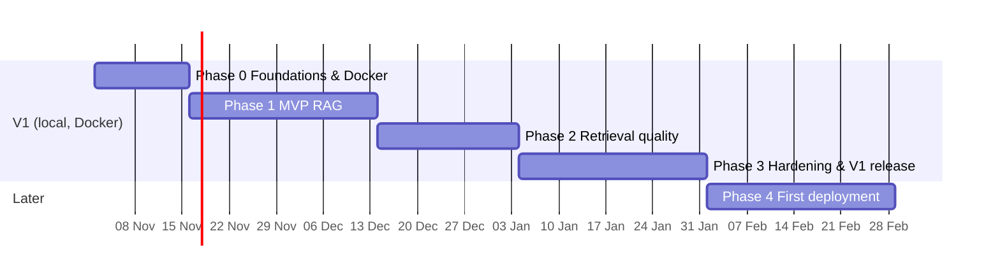
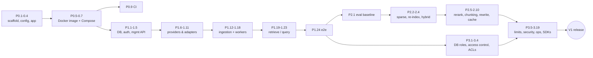

# Enterprise RAG Service — Phase-wise Implementation Plan

| | |
|---|---|
| **Status** | v1.1 — **Phase 0 and Phase 1 implemented** (see below); Phase 2 next |
| **Date** | 2026-11-01 |
| **Companion doc** | [ARCHITECTURE.md](ARCHITECTURE.md) explains *what* is built and *why*. This document covers *how* and *in what order*. |
| **V1 scope** | Phases 0–3: **fully Dockerized, runs locally with Docker Compose, uses OpenAI** for embeddings and generation, and uses your **existing local PostgreSQL 18.6** (no Postgres container, §3.5). Single organization: no multi-tenancy (ADR 0009) |

### Implementation status (2026-11-01)

Phases 0 and 1 are implemented. These are the deviations from the plan as originally written, each with its reason:

| Plan said | Implemented | Why |
|---|---|---|
| Python 3.12 | **Python 3.14** on host and in images | It's the interpreter already installed; no extra Python downloads. Its stdlib has `uuid.uuid7()`, so `uuid-utils` was dropped |
| MinIO + `minio-init` | **SeaweedFS** S3 gateway; bucket created by the `bootstrap` job | MinIO no longer publishes community images (ADR 0008). The app only uses the S3 API |
| Separate `migrate` service | One **`bootstrap`** job: migrations + bucket + Qdrant collection | One idempotent setup step instead of three containers |
| `python-magic` | **`filetype`** (pure Python) | No `libmagic` system library needed on Windows hosts |
| `gpt-5-mini` | **`gpt-4o`** (`gpt-4o-mini` for utility tasks) | Chosen for V1; reasoning effort is only sent for reasoning models |
| Fake OpenAI as its own image | Runs from the **`rag-service` image** with the script mounted | No extra image build (and no extra PyPI download) |
| Multi-tenant model | **API clients + KB allow-lists** | The service is single-organization (ADR 0009) |

---

## Table of Contents

1. [Overview & Timeline](#1-overview--timeline)
2. [Working Conventions](#2-working-conventions)
3. [Docker Strategy for V1 (applies to every phase)](#3-docker-strategy-for-v1-applies-to-every-phase)
4. [Phase 0 — Foundations & Docker Stack](#4-phase-0--foundations--docker-stack)
5. [Phase 1 — MVP: Ingest → Retrieve → Answer](#5-phase-1--mvp-ingest--retrieve--answer)
6. [Phase 2 — Retrieval Quality](#6-phase-2--retrieval-quality)
7. [Phase 3 — Hardening & V1 Release](#7-phase-3--hardening--v1-release)
8. [V1 Release Checklist](#8-v1-release-checklist)
9. [Phase 4 — First Non-Local Deployment (outline)](#9-phase-4--first-non-local-deployment-outline)
10. [Phase 5 — Advanced Capabilities (outline)](#10-phase-5--advanced-capabilities-outline)
11. [Dependencies & Critical Path](#11-dependencies--critical-path)
12. [Phase Risks](#12-phase-risks)

---

## 1. Overview & Timeline

Estimates assume **one developer working full-time**. Scale them to your actual availability. Each phase ends in a runnable, demoable state. Nothing stays "half-built" across a phase boundary.

| Phase | Weeks | Theme | Runs on | Demo at end of phase |
|---|---|---|---|---|
| **0** | 1–2 | Foundations & Docker stack | Docker Compose | `docker compose up` → all services healthy, CI green |
| **1** | 3–6 | MVP: ingest → retrieve → answer | Docker Compose + OpenAI | Upload PDFs, ask questions, get streamed answers with citations |
| **2** | 7–9 | Retrieval quality | Docker Compose + OpenAI | Hybrid search + reranking, eval report shows improvement over Phase 1 |
| **3** | 10–13 | Hardening & **V1 release** | Docker Compose + OpenAI | Access-controlled (per-app KB allow-lists, document ACLs), rate-limited, observable, SDKs, backups |
| 4 | 14–17 | First server/cloud deployment | Kubernetes | Same images running on a cluster |
| 5 | ongoing | Advanced capabilities | — | MCP server, multimodal, agentic retrieval |



---

## 2. Working Conventions

These conventions hold for every phase. They're set up in Phase 0, so later phases don't need to repeat them.

| Convention | Rule | Why |
|---|---|---|
| Work item IDs | `P<phase>.<n>` (e.g. `P1.7`), used in branch names (`feat/P1.7-ingest-workflow`) and commit messages | Traceability from plan → code → PR |
| Branching | Short-lived feature branches off `main`; PR + green CI to merge; squash merge | Keeps `main` always deployable |
| Commits | Conventional Commits (`feat:`, `fix:`, `chore:`, `docs:`, `test:`) | Automatic changelog + semver later |
| Definition of Done (every item) | Code + tests + type-checks pass + docs/ADR updated if behavior or decisions changed + runs in Docker Compose | "Works on my machine outside Docker" doesn't count |
| Task runner | **poethepoet** tasks in `pyproject.toml`, run as `uv run poe <task>` | Works the same on Windows, macOS, Linux. Make isn't installed on Windows by default, and `just` would be an extra tool to install. |
| Secrets | Only in `.env` (git-ignored); `.env.example` committed with placeholders | Never leak the OpenAI key |
| Python environment | Everything installs into the repo-local `.venv` (created with `python -m venv .venv` from the existing Python 3.14). `uv` lives inside `.venv`; its cache is `.uv-cache/` in the repo, and Python downloads are disabled (`[tool.uv]` in `pyproject.toml`) | Never modify global/user Python packages or install extra interpreters on the dev machine |
| Line endings | `.gitattributes` with `* text=auto eol=lf` | Windows CRLF line endings break shell scripts and entrypoints inside Linux containers |
| Tests against OpenAI | Mocked by default (`respx`); real-API tests marked `@pytest.mark.live`, run only on demand | Fast, free, deterministic CI |

### Standard task commands (defined in P0.1)

```bash
uv run poe up          # docker compose up -d --wait   (dev mode, hot reload)
uv run poe up-prod     # docker compose -f compose.yaml up -d --wait  (prod-like, no override)
uv run poe down        # docker compose down
uv run poe logs        # docker compose logs -f --tail=200
uv run poe migrate     # docker compose run --rm migrate
uv run poe lint        # ruff check + ruff format --check + mypy
uv run poe test        # pytest unit + integration
uv run poe e2e         # pytest e2e against the running compose stack
uv run poe eval        # offline retrieval/generation eval (Phase 2+)
uv run poe seed        # create a demo KB, API key, sample docs
uv run poe backup      # pg_dump + qdrant snapshot + S3 bucket sync (Phase 3)
```

---

## 3. Docker Strategy for V1 (applies to every phase)

**Principle:** from Phase 0 on, *everything* runs in containers, including the application services, not just the databases. The host only needs **Docker Desktop (WSL2 backend), Git, and uv** (for IDE support, linting and running tests).

*Why containerize the app itself in V1, not just the infrastructure:*
1. Identical environment for every developer and CI. No "works with my Python version".
2. The **same images** become the Kubernetes workloads in Phase 4, so the move to a cluster is a deployment change, not a packaging project.
3. Container issues (non-root permissions, read-only filesystems, missing system libraries such as `libmagic` or Tesseract) show up in week 1 instead of at deployment time.

### 3.1 Images

| Image | Dockerfile | Contents | Approx. size | Used by |
|---|---|---|---|---|
| `rag-service` | `deploy/docker/Dockerfile` | Python 3.14-slim, app code, runtime deps (no parser stack) | ~250–350 MB | `rag-api`, `rag-query`, `index-worker`, `migrate`, maintenance tasks |
| `rag-parser` | `deploy/docker/Dockerfile.parser` | `rag-service` base + Docling + Tesseract OCR + `libmagic`, layout/OCR models **baked in at build time** | ~2.5–3.5 GB | `parse-worker` only |

*Why two images:* the parser stack (PyTorch CPU, layout models, OCR) is roughly 10× the size of everything else. Keeping it out of the API image keeps API/query containers small, fast to start, and smaller as an attack surface.
*Why bake models into the parser image:* without it, every fresh container would download hundreds of MB from Hugging Face at startup. That's slow, it fails offline, and it isn't reproducible.

**`rag-service` Dockerfile design (multi-stage):**

```dockerfile
# syntax=docker/dockerfile:1.7
ARG PYTHON_VERSION=3.14

# ---- builder: resolve and install deps with uv ----
FROM python:${PYTHON_VERSION}-slim AS builder
COPY --from=ghcr.io/astral-sh/uv:<pinned-version> /uv /uvx /bin/
ENV UV_COMPILE_BYTECODE=1 UV_LINK_MODE=copy UV_PYTHON_DOWNLOADS=never
WORKDIR /app
# 1) deps layer — cached until pyproject/uv.lock change
RUN --mount=type=cache,target=/root/.cache/uv \
    --mount=type=bind,source=uv.lock,target=uv.lock \
    --mount=type=bind,source=pyproject.toml,target=pyproject.toml \
    uv sync --frozen --no-install-project --no-dev
# 2) project layer
COPY src/ src/
COPY migrations/ migrations/
COPY alembic.ini pyproject.toml uv.lock ./
RUN --mount=type=cache,target=/root/.cache/uv uv sync --frozen --no-dev

# ---- runtime ----
FROM python:${PYTHON_VERSION}-slim AS runtime
RUN apt-get update && apt-get install -y --no-install-recommends libmagic1 tini \
    && rm -rf /var/lib/apt/lists/*
RUN groupadd -g 10001 app && useradd -u 10001 -g app -s /sbin/nologin -M app
WORKDIR /app
COPY --from=builder --chown=app:app /app /app
ENV PATH="/app/.venv/bin:$PATH" PYTHONUNBUFFERED=1 PYTHONDONTWRITEBYTECODE=1
USER app
ENTRYPOINT ["tini", "--", "rag-service"]
CMD ["api"]
```

| Choice | Why |
|---|---|
| Multi-stage with `uv sync --frozen` | Reproducible installs from the lockfile; build tools never ship in the runtime image |
| Deps layer before code layer | Code edits rebuild in seconds because the dependency layer stays cached |
| BuildKit cache mounts | uv's download cache survives between builds |
| Non-root UID 10001 | Kubernetes `runAsNonRoot` compatibility; limits damage if a container is compromised |
| `tini` as PID 1 | Forwards SIGTERM properly → graceful shutdown (drains SSE streams, lets Temporal workers finish activities) and reaps zombie processes |
| No `HEALTHCHECK` in the image | Health checks are defined per service in Compose (and as probes in Kubernetes), because API and worker check different things |
| Pinned base and tool versions | Builds stay the same over time and can't drift silently |

### 3.2 Compose file layout

```
compose.yaml                     # base: infra + app services, prod-like defaults
compose.override.yaml            # dev only (auto-loaded): Compose Watch, --reload, debug ports
compose.observability.yaml       # opt-in: Langfuse stack, Prometheus, Grafana (Phase 2–3)
deploy/compose/
  postgres/init/                 # used only by the bundled-postgres profile (CI); reuses scripts/db/init_local.sql
scripts/db/
  init_local.sql                 # one-time setup on your local PostgreSQL 18.6 (databases + roles)
  seaweedfs/start-seaweedfs.sh   # S3 gateway with credentials from .env
  prometheus/prometheus.yml      # Phase 3
  grafana/dashboards/*.json      # Phase 3
.dockerignore
.env.example
```

*Why base + override:* `docker compose up` gives the developer experience (hot reload) automatically, while `docker compose -f compose.yaml up` runs exactly what production will run. Same files, two modes, no duplication.

### 3.3 Service conventions in Compose

| Convention | Detail | Why |
|---|---|---|
| Health checks on every service | e.g. Redis `redis-cli ping`, Qdrant `/readyz`, app `/readyz` (which also checks the host Postgres) | `docker compose up --wait` and CI can tell when the stack is actually ready |
| Startup ordering | `depends_on: {bootstrap: {condition: service_completed_successfully}}`; `bootstrap` waits for Postgres itself with a short connect-retry loop (the host Postgres isn't a Compose service, so it can't have a Compose health check) | App services never start before the DB schema is migrated |
| Host Postgres access | `extra_hosts: ["host.docker.internal:host-gateway"]` on every service that talks to Postgres | Docker Desktop provides `host.docker.internal` already. The explicit mapping also makes it work on Linux CI. |
| One-shot jobs | `bootstrap` (Alembic migrations, bucket creation, Qdrant collection) runs once and exits | Same pattern as Kubernetes Jobs / Helm hooks later |
| Named volumes | `qdrant_data`, `seaweedfs_data`, `temporal_data` (Redis runs without persistence; it's only a cache) (Postgres data lives in your existing `D:\C Drive\PostgreSQL\data`) | Data survives `docker compose down` (only `down -v` wipes it) |
| Single network | `rag-net` | Services resolve each other by name (`qdrant`, `redis`, …) |
| Port exposure | App ports on `localhost` (8000, 8001); infra ports bound to `127.0.0.1` only; UIs: Temporal 8233, Qdrant dashboard 6333, SeaweedFS S3 API 8333 | Keeps databases off your LAN while still reachable for debugging |
| Config | `env_file: .env` + per-service `environment:` overrides | One place for secrets; service-specific settings stay explicit |
| Resource limits | `parse-worker` memory limit 4 GB, CPU 2; others modest | Stops a huge PDF from OOM-killing the WSL VM and everything in it |
| Restart policy | `restart: unless-stopped` for long-running services | Survives crashes and Docker Desktop restarts |
| Pinned image tags | e.g. `qdrant/qdrant:v1.x.y`, `redis:7.x` (exact versions chosen in P0.6); `postgres:18.6` for CI only, matching your local install | No surprise upgrades from `latest` |
| Dev hot reload | **Compose Watch** (`develop.watch` → `sync` `./src` into the container; `rebuild` on `uv.lock` change) | Bind mounts from Windows into Linux containers are slow and miss file events. Compose Watch syncs only changed files and reacts to dependency changes. |

### 3.4 V1 service catalogue and when each one arrives

| Service | Image | Added in | Purpose |
|---|---|---|---|
| *(host)* PostgreSQL 18.6 | your existing Windows install | P0 | System of record (not a container, §3.5) |
| `postgres` *(profile `bundled-postgres`)* | `postgres:18.6` | P0 | CI / machines without a local Postgres only |
| `redis` | `redis:7` | P0 | Cache, rate limiting, idempotency |
| `qdrant` | `qdrant/qdrant` | P0 | Vector + sparse index |
| `seaweedfs` | `chrislusf/seaweedfs` | P0 | S3-compatible document storage (replaces MinIO, ADR 0008) |
| `temporal` | `temporalio/temporal` (dev server) | P0 | Workflow engine + UI |
| `rag-api` | `rag-service` | P0 (health only) → P1 | Management + ingestion API |
| `rag-query` | `rag-service` | P0 (health only) → P1 | Retrieve / query API |
| `bootstrap` | `rag-service` | P0–P1 | One-shot: migrations, bucket, Qdrant collection |
| `parse-worker` | `rag-parser` | P1 | Parsing/OCR activities |
| `index-worker` | `rag-service` | P1 | Chunk/embed/upsert activities |
| `tei-rerank` | `text-embeddings-inference:cpu-<ver>` | P2 | CPU cross-encoder reranker |
| `langfuse` stack | Langfuse images | P2 (profile) | RAG trace debugging |
| `clamav` | `clamav/clamav` | P3 | Malware scanning of uploads |
| `prometheus`, `grafana` | official images | P3 (profile) | Metrics + dashboards |
| `k6` | `grafana/k6` | P3 (run on demand) | Load tests |

### 3.5 Using your existing PostgreSQL 18.6

Your machine already runs **PostgreSQL 18.6** as the Windows service `postgresql-x64-18` on port 5432 (binaries in `D:\C Drive\PostgreSQL\bin`). It meets the design's minimum (16+), so **V1 uses it directly and no other Postgres version is installed.** Full reasoning is in [ARCHITECTURE.md §0.8](ARCHITECTURE.md).

**One-time setup (part of P0.6):**

1. **Create databases and roles.** Run as the `postgres` superuser:
   ```powershell
   & "D:\C Drive\PostgreSQL\bin\psql.exe" -U postgres -h 127.0.0.1 `
     -v owner_pw="<strong-password>" -v app_pw="<strong-password>" `
     -f scripts/db/init_local.sql
   ```
   `scripts/db/init_local.sql` (written in P0.6) does the following:
   ```sql
   CREATE ROLE rag_owner LOGIN PASSWORD :'owner_pw';                  -- owns schema, runs migrations
   CREATE ROLE rag_app   LOGIN PASSWORD :'app_pw' NOSUPERUSER;                -- runtime role, DML only
   CREATE DATABASE rag      OWNER rag_owner;
   CREATE DATABASE rag_test OWNER rag_owner;
   \connect rag
   REVOKE ALL ON SCHEMA public FROM PUBLIC;
   GRANT USAGE ON SCHEMA public TO rag_app;
   ALTER DEFAULT PRIVILEGES FOR ROLE rag_owner IN SCHEMA public
     GRANT SELECT, INSERT, UPDATE, DELETE ON TABLES TO rag_app;
   ALTER DEFAULT PRIVILEGES FOR ROLE rag_owner IN SCHEMA public
     GRANT USAGE, SELECT ON SEQUENCES TO rag_app;
   -- same grants repeated for rag_test
   ```
   *Why two roles:* least privilege. Tables are owned by `rag_owner`, and the app runs as `rag_app`, which can read and write rows but can't drop tables or change the schema. Only the one-shot `migrate` job uses the owner role.
2. **Allow Docker containers** to connect by adding one line to `D:\C Drive\PostgreSQL\data\pg_hba.conf`, then reloading (`SELECT pg_reload_conf();` as `postgres`, no restart):
   ```
   host    rag,rag_test    rag_owner,rag_app    192.168.65.0/24    scram-sha-256
   ```
   `192.168.65.0/24` is Docker Desktop's default subnet, and your existing `agent_runtime` entry already uses it. If Docker Desktop is set to a different subnet (Settings → Resources → Network), use that one.
3. **Configure `.env`:**
   ```dotenv
   # used by containers
   RAG_DATABASE_URL=postgresql+asyncpg://rag_app:<app_pw>@host.docker.internal:5432/rag
   RAG_MIGRATION_DATABASE_URL=postgresql+asyncpg://rag_owner:<owner_pw>@host.docker.internal:5432/rag
   # used by tests/tools running directly on Windows
   RAG_TEST_DATABASE_URL=postgresql+asyncpg://rag_owner:<owner_pw>@127.0.0.1:5432/rag_test
   RAG_PG_BIN=D:\C Drive\PostgreSQL\bin
   ```
4. **Verify** with `uv run poe db-check`, a task that connects as both roles from the host *and* from inside a container. It prints the server version and confirms `rag_app` isn't a superuser and doesn't own the tables.

**What changes elsewhere in the plan because of this:**

| Area | Change |
|---|---|
| Compose | No `postgres` service in the default stack. App services reach the host server via `host.docker.internal`. A `postgres:18.6` service exists only under the `bundled-postgres` profile, for CI. |
| Integration tests | Locally they use the `rag_test` database on your server (fast, no image pull). In CI, Testcontainers start `postgres:18.6`. The fixture picks based on whether `RAG_TEST_DATABASE_URL` is set. |
| IDs | Tables use the PostgreSQL 18 built-in `DEFAULT uuidv7()`; the app uses Python 3.14's built-in `uuid.uuid7()` only when it needs the ID before insert. |
| Backups | `poe backup` / `poe restore` call `pg_dump.exe` / `pg_restore.exe` from `RAG_PG_BIN`, which match the server version. |
| Connection pools | ~25 connections total across services (your server allows 100, shared with other databases). No PgBouncer in V1. |
| Phase 4 | Target PostgreSQL 18 on the server/managed service, so data moves without a major-version downgrade. |

---

## 4. Phase 0 — Foundations & Docker Stack

**Weeks 1–2 · Goal:** a clean, typed, tested skeleton where every service (including two empty app services) runs in Docker Compose and CI verifies it.

### Work items

| ID | Work item | Key files | Done when |
|---|---|---|---|
| **P0.1** | **Repo scaffold & tooling** — `uv init --package`, `src/rag_service/` layout (ARCHITECTURE §20), ruff + mypy (strict on `src/`) + pytest config in `pyproject.toml`, pre-commit hooks, poethepoet tasks (§2), `.gitattributes` (LF), `.editorconfig` | `pyproject.toml`, `uv.lock`, `.pre-commit-config.yaml`, `.gitattributes` | `uv run poe lint` and `uv run poe test` pass on an empty test suite |
| **P0.2** | **Core config** — `Settings` with `pydantic-settings`: nested groups (db, redis, qdrant, s3, temporal, openai, app). `OPENAI_API_KEY` as `SecretStr`. Fail fast on missing required settings at startup. | `core/config.py`, `.env.example` | App refuses to start with a clear error if a required variable is missing; the key never appears in logs or `repr` |
| **P0.3** | **Logging, errors, middleware** — `structlog` JSON logs (pretty console in dev), request-ID middleware (`X-Request-ID`), RFC 9457 Problem Details error handlers, global exception handler that logs with `trace_id` and returns no internals | `core/logging.py`, `core/errors.py`, `api/middleware.py` | Unit tests: unknown error → 500 problem+json with request ID, no stack trace in the response |
| **P0.4** | **App entrypoints** — `typer` CLI `rag-service {api,query,worker,migrate,bootstrap,db-check}`. Two FastAPI app factories (`create_api_app`, `create_query_app`) sharing core wiring. `/healthz` (liveness) and `/readyz` (pings PG, Redis, Qdrant, SeaweedFS, Temporal with short timeouts). Lifespan handlers open/close connection pools. | `main.py`, `api/app.py`, `api/health.py` | `/readyz` returns 503 with which dependency failed when one is down |
| **P0.5** | **Docker: app image** — `deploy/docker/Dockerfile` per §3.1, `.dockerignore` (excludes `.venv`, `.git`, tests data, `.env`) | `deploy/docker/Dockerfile`, `.dockerignore` | Image builds; runs as UID 10001; `docker run rag-service --help` works; size < 400 MB |
| **P0.6** | **Local Postgres setup + Docker Compose base stack** — `scripts/db/init_local.sql`, `pg_hba.conf` line and `poe db-check` per §3.5 (uses your existing PostgreSQL 18.6). `compose.yaml` with `redis`, `qdrant`, `seaweedfs`, `temporal`, `bootstrap`, `rag-api`, `rag-query` (`extra_hosts` → host Postgres); health checks, volumes, network, pinned tags, `127.0.0.1` port bindings; `bundled-postgres` profile (`postgres:18.6`) for CI | `scripts/db/init_local.sql`, `compose.yaml`, `deploy/compose/**` | `poe db-check` passes from host and container; `docker compose -f compose.yaml up -d --wait` → all healthy; `curl localhost:8000/readyz` → 200 (incl. Postgres) |
| **P0.7** | **Docker: dev override** — `compose.override.yaml` with Compose Watch on `src/`, `uvicorn --reload`, `LOG_FORMAT=console` | `compose.override.yaml` | Editing a route in `src/` is reflected in the running container within ~2 s, no rebuild |
| **P0.8** | **Test harness** — pytest layout (`unit/`, `integration/`, `e2e/`), `pytest-asyncio`; Postgres fixture uses local `rag_test` on your 18.6 server when `RAG_TEST_DATABASE_URL` is set, else Testcontainers `postgres:18.6`; Testcontainers for Redis/Qdrant/SeaweedFS; `respx` fixture that blocks real outbound HTTP by default; **PG 18 compatibility smoke test** (asyncpg connect, Alembic upgrade/downgrade, `uuidv7()`) | `tests/conftest.py`, `tests/integration/conftest.py` | Sample integration test passes against your local server and against the CI container |
| **P0.9** | **CI (GitHub Actions)** — jobs: `lint` (ruff, mypy), `test` (unit + integration; Docker is available on `ubuntu-latest`), `docker` (build both images with layer cache), `smoke` (`docker compose -f compose.yaml --profile bundled-postgres up -d --wait` + curl `/readyz` + `docker compose logs` on failure) | `.github/workflows/ci.yml` | PRs show 4 green checks; failing smoke test prints container logs |
| **P0.10** | **ADRs** — 0001 modular monolith, 0002 PostgreSQL, 0003 Qdrant, 0004 Temporal, 0005 OpenAI for V1 behind provider interfaces, 0006 Docker Compose as V1 runtime, 0007 Python/FastAPI/uv tooling | `docs/adr/*.md` | Each ADR: context, decision, alternatives, consequences |
| **P0.11** | **Developer README** — prerequisites (Docker Desktop + WSL2 memory setting, uv, local PostgreSQL 16+ or the `bundled-postgres` profile), one-time DB setup (§3.5), quickstart, task list, service URLs/ports, troubleshooting (ports in use, WSL memory, CRLF) | `README.md` | A fresh clone can get to a healthy stack by following only the README |

### Phase 0 exit criteria

- [ ] Local PostgreSQL 18.6 has the `rag` / `rag_test` databases and `rag_owner` / `rag_app` roles; `poe db-check` green.
- [ ] Fresh clone → `cp .env.example .env` → `uv run poe up` → every container healthy in < 3 minutes (after first image pull).
- [ ] `/healthz` and `/readyz` on both 8000 and 8001; Temporal UI on 8233; Qdrant dashboard on 6333; SeaweedFS S3 API on 8333.
- [ ] CI green on `main`: lint, type-check, tests, image builds, compose smoke test.
- [ ] ADRs merged.

---

## 5. Phase 1 — MVP: Ingest → Retrieve → Answer

**Weeks 3–6 · Goal:** the thinnest end-to-end slice that's still built "properly": real access-control model (API clients + scopes), real Temporal workflows, real versioned collections. Dense retrieval only, OpenAI for embeddings and answers.

*Why build the slice vertically first:* it validates every integration (S3 → Docling → OpenAI → Qdrant → LLM → SSE) early. Building each layer perfectly in isolation hides integration surprises until late.

### 5.1 Data layer & auth (week 3)

| ID | Work item | Key files | Done when |
|---|---|---|---|
| **P1.1** | **SQLAlchemy models + initial Alembic migration** — tables from ARCHITECTURE §6.1: `api_clients`, `knowledge_bases`, `documents`, `chunks`, `ingestion_jobs`, `query_logs` (monthly partitions + creation helper), `usage_events`. IDs are UUIDv7: `DEFAULT uuidv7()` (built into PostgreSQL 18) plus `uuid.uuid7()` from the Python 3.14 standard library when an ID is needed before insert. Tables owned by `rag_owner`. Indexes incl. `unique(kb_id, external_id)`, GIN on `documents.metadata`. | `storage/db/models.py`, `migrations/versions/0001_initial.py` | Upgrade + downgrade pass on an empty DB in CI |
| **P1.2** | **Docker: `bootstrap` job** — one-shot `rag-service bootstrap` (Alembic `upgrade head`, bucket, Qdrant collection) connecting to the host Postgres as `rag_owner` via `RAG_MIGRATION_DATABASE_URL`, with a connect-retry loop; app services `depends_on` it with `service_completed_successfully` | `compose.yaml` | Fresh `poe up` creates the schema automatically; a failed migration blocks app startup |
| **P1.3** | **Repositories & access context** — async session factory (asyncpg); KB lookups take an `AccessContext` (the calling API client and its KB allow-list), so KB access checks live in one place | `storage/db/session.py`, `storage/repositories/*.py`, `core/access.py` | Unit tests: a client restricted to KB A gets 404 for KB B |
| **P1.4** | **API-key auth** — key format `rag_<env>_<prefix8>_<secret32>`, HMAC-SHA256 hash with a server pepper from `.env`, lookup by prefix (cached in Redis 5 min), scopes, `last_used_at` updated asynchronously. Bootstrap admin key from `RAG_BOOTSTRAP_ADMIN_KEY` | `core/security.py`, `api/deps.py` | Invalid/revoked/expired key → 401 problem+json; scope missing → 403 |
| **P1.5** | **Management API** — create/list/revoke API clients (key shown once; `clients:manage` or `admin` scope), KBs CRUD with config defaults from service settings | `api/v1/api_clients.py`, `api/v1/knowledge_bases.py`, `api/schemas/*` | OpenAPI shows all endpoints; integration tests for CRUD + 404 for KBs outside a client's allow-list |

### 5.2 Providers & storage adapters (week 3–4)

| ID | Work item | Key files | Done when |
|---|---|---|---|
| **P1.6** | **Provider interfaces** — `EmbeddingProvider`, `LLMProvider`, `VectorStore`, `Parser`, `Chunker`, `Reranker` protocols (ARCHITECTURE §21) + a registry that resolves an implementation by name from KB config | `providers/base.py`, `providers/registry.py` | Fake implementations used in unit tests |
| **P1.7** | **OpenAI embedding provider** — `AsyncOpenAI`, `text-embedding-3-large`, `dimensions=1024`, batches of ~100 inputs, input token pre-check with `tiktoken` (`cl100k_base`), returns vectors + token usage | `providers/embeddings/openai.py` | respx-mocked tests for batching and retries; one `@live` test |
| **P1.8** | **OpenAI rate limiter & resilience** — Redis token bucket for RPM + TPM with a reserved share for the query path; `tenacity` backoff with jitter on 429/5xx honoring `retry-after`; per-call timeouts | `providers/ratelimit.py`, `core/resilience.py` | Simulated 429 storm: no failures, requests spread out; query path still gets capacity |
| **P1.9** | **OpenAI LLM provider** — Responses API, streaming mapped to internal `GenerationEvent`s (`delta`, `done` with usage), model from config (`gpt-4o` default; reasoning effort only sent for reasoning models), usage → `usage_events` with cost from a price table in config | `providers/llm/openai.py` | Streaming unit tests with recorded event fixtures |
| **P1.10** | **Qdrant vector store** — collection bootstrap (`chunks__openai-te3-large-1024__v1`, dense named vector, int8 scalar quantization, `on_disk_payload`, payload indexes incl. `kb_id` with `is_tenant: true`), alias `chunks_active`, upsert in batches of 256 with `wait=true`, search with a **mandatory** KB filter, delete by document / by version | `providers/vectorstores/qdrant.py`, `ingestion/bootstrap.py` | Integration test (Testcontainers Qdrant): a search without KB IDs can't be constructed; KB filter isolation verified |
| **P1.11** | **Object storage adapter** — `aioboto3` against SeaweedFS's S3 API; key layout from ARCHITECTURE §5.4; streaming upload (no full file in memory) | `storage/object_store.py` | Integration test against SeaweedFS container |

### 5.3 Ingestion pipeline (week 4–5)

| ID | Work item | Key files | Done when |
|---|---|---|---|
| **P1.12** | **Upload endpoint** — `POST /v1/knowledge-bases/{kb}/documents`: multipart file or JSON `{text, title}`; `external_id`, `metadata`, `acl` fields; MIME check by magic bytes (`filetype`, pure Python), size limit; SHA-256 content hash; same hash for same `external_id` → return existing doc (200); else store original in SeaweedFS, insert `documents` + `ingestion_jobs`, start Temporal workflow → `202 {document_id, job_id}` | `api/v1/documents.py`, `domain/documents.py` | Re-uploading an identical file does zero work; a wrong file type → 415 |
| **P1.13** | **Temporal workflow** — `IngestDocumentWorkflow(document_id, version)` with activities `parse` (task queue `parse`), `chunk`, `embed`, `upsert`, `cleanup_old_versions`, `finalize` (queue `index`); per-activity timeouts + retry policies from ARCHITECTURE §7.2; status/stage updates written to PG at each step; failure → `failed` with structured error | `ingestion/workflows.py`, `ingestion/activities.py`, `workers/main.py` | Killing a worker mid-workflow → workflow resumes on restart and completes |
| **P1.14** | **Parser (Docling)** — PDF/DOCX/PPTX/HTML/MD/TXT → `ParsedDocument` (sections, headings, paragraphs, tables as Markdown, page numbers); OCR only for pages without a text layer; parsed JSON saved to SeaweedFS | `ingestion/parsers/docling_parser.py`, `ingestion/parsers/text.py` | Fixture set (`tests/fixtures/docs/`: text PDF, scanned PDF, DOCX with table, HTML) parses with expected structure |
| **P1.15** | **Docker: parser image + workers** — `Dockerfile.parser` (Tesseract, Docling, models downloaded at build into the image), `parse-worker` (memory limit 4 GB, `hf_cache` volume) and `index-worker` services in Compose | `deploy/docker/Dockerfile.parser`, `compose.yaml` | Both workers register with Temporal (visible in UI on 8233); CI builds the parser image with layer cache |
| **P1.16** | **Recursive chunker** — structure-aware split (sections → paragraphs → sentences), ~512 tokens (`tiktoken`), 10–15% overlap, tables kept whole when they fit, `heading_path` + page range per chunk, deterministic chunk IDs per (document, version, ordinal) | `ingestion/chunkers/recursive.py` | Property tests (`hypothesis`): no chunk exceeds the limit, no text lost, order preserved |
| **P1.17** | **Delete document** — `DELETE` → status `deleting` (hidden from search immediately via status filter) → `DeleteDocumentWorkflow` removes Qdrant points, chunk rows, SeaweedFS objects | `ingestion/workflows.py`, `api/v1/documents.py` | Deleted doc never appears in retrieval, even before the workflow finishes |
| **P1.18** | **Document & job read APIs** — get/list documents (cursor pagination, status filter), `GET /v1/jobs/{id}` with stage + error | `api/v1/documents.py`, `api/v1/jobs.py` | Pagination tests; job shows stage progression |

### 5.4 Retrieval & generation (week 5–6)

| ID | Work item | Key files | Done when |
|---|---|---|---|
| **P1.19** | **`POST /v1/retrieve`** — embed query (OpenAI), dense search (top_k default 8) across 1..n KBs the client may access, return chunks with score, document/title/page, `heading_path` | `retrieval/pipeline.py`, `api/v1/retrieve.py` | Integration test with seeded vectors; KB IDs outside the allow-list → 404 |
| **P1.20** | **Prompting & context** — versioned system prompt (answer only from sources, cite `[n]`, say "I don't know based on the provided documents" when unsupported, treat sources as data), sources wrapped as `<source id="n" …>`, token budget (6k) | `generation/prompts/answer_v1.md`, `retrieval/context.py` | Snapshot tests of the rendered prompt |
| **P1.21** | **`POST /v1/query` with SSE** — `sse-starlette`; events `retrieval` → `delta`* → `done` / `error`; non-stream mode returns full JSON; client disconnect cancels the LLM call | `api/v1/query.py`, `generation/generator.py` | Manual check with `curl -N`; test asserts event order |
| **P1.22** | **Citation post-processing** — parse `[n]`, map to chunk/document/page, drop invalid markers, flag `no_citations` | `generation/citations.py` | Unit tests incl. malformed/missing citations |
| **P1.23** | **Query logging & usage** — write `query_logs` + `usage_events` off the hot path (background task), per-stage latency | `domain/query_log.py` | Response time unaffected by a slow DB write (tested with injected delay) |

### 5.5 Phase 1 testing & demo

| ID | Work item | Done when |
|---|---|---|
| **P1.24** | **E2E suite** against the Compose stack (OpenAI mocked through a fake-OpenAI container or `RAG_OPENAI_BASE_URL` pointing to a stub, so CI needs no key): create API client → KB → upload 3 fixture docs → poll until `ready` → retrieve → query (stream) → delete → verify gone | `uv run poe e2e` green locally and in CI |
| **P1.25** | **Seed & demo script** — `uv run poe seed` creates a demo KB and API key and ingests `examples/sample_docs/`; README "Try it" section with curl examples | A new user gets a cited answer in < 10 min from clone (with their OpenAI key) |

*Why a stub OpenAI server for e2e:* CI shouldn't need your API key or spend money. The OpenAI SDK supports a custom `base_url`, so the same code path runs in tests and with the real API.

### Phase 1 exit criteria

- [ ] Upload PDF/DOCX/HTML/text → `ready` within ~2 min for a 20-page document on a laptop.
- [ ] `/v1/query` streams an answer with valid citations; `/v1/retrieve` returns ranked chunks.
- [ ] Re-uploading unchanged files costs nothing (verified via `usage_events`).
- [ ] Deletes remove content from search immediately.
- [ ] Worker crash mid-ingestion recovers automatically.
- [ ] E2E suite green in CI with stubbed OpenAI.

---

## 6. Phase 2 — Retrieval Quality

**Weeks 7–9 · Goal:** measurably better answers, proven with an evaluation harness rather than impressions.

*Why the eval harness comes first in this phase (P2.1):* every later item in Phase 2 is a quality change. Without a baseline, you can't tell if hybrid search or a new chunker actually helped.

| ID | Work item | Key files | Done when |
|---|---|---|---|
| **P2.1** | **Evaluation harness + golden set** — script that generates candidate Q/A pairs from documents (`gpt-4o`), human review step, `eval/datasets/<kb>.jsonl`; metrics: Recall@k, MRR, nDCG@10, faithfulness, answer relevance, citation accuracy (LLM-as-judge); results saved as JSON + Markdown report; **Phase 1 baseline recorded** | `eval/generate_dataset.py`, `eval/run_eval.py`, `eval/baselines/phase1.json` | `uv run poe eval` produces a report with the baseline |
| **P2.2** | **BM25 sparse vectors** — `fastembed` `Qdrant/bm25` in index-worker and query service; new collection `chunks__openai-te3-large-1024__v2` with `dense` + `sparse` (IDF modifier) | `providers/sparse/bm25.py` | Sparse vectors stored for all new chunks |
| **P2.3** | **Blue/green re-index workflow** — `ReindexKnowledgeBaseWorkflow`: fan out child workflows that re-chunk/re-embed from parsed JSON in SeaweedFS (no re-parse) into the new collection; reuse unchanged dense vectors when possible; swap alias only after eval passes; rollback = swap back | `ingestion/reindex.py` | v1 → v2 migration of the demo KB with zero failed queries during the switch |
| **P2.4** | **Hybrid retrieval with RRF** — single Qdrant Query API call: prefetch dense top-50 + sparse top-50 → RRF fusion | `retrieval/pipeline.py`, `retrieval/fusion.py` | Eval: Recall@10 improves over baseline, especially on exact-term queries (IDs, codes) |
| **P2.5** | **Docker: `tei-rerank` service** — TEI CPU image serving `cross-encoder/ms-marco-MiniLM-L-6-v2`, model cache volume, health check; `TEIReranker` provider; rerank top-30 → top-8 with score threshold; **graceful degradation** (reranker down → fused results + `degraded: true`) | `compose.yaml`, `providers/rerankers/tei.py` | Eval: precision gain; stopping the container doesn't break queries |
| **P2.6** | **Structure-aware chunking upgrades** — contextual header (`title > heading path`) prepended to embedded text; table row-group splitting with repeated header; optional parent-child (small-to-big) per KB config | `ingestion/chunkers/*.py`, `ingestion/enrichers/contextual_header.py` | Eval comparison per strategy documented |
| **P2.7** | **Context assembly** — dedupe overlapping chunks, merge adjacent chunks of the same section, parent expansion, relevance-aware ordering, token budget | `retrieval/context.py` | Unit tests + eval faithfulness not worse |
| **P2.8** | **Conversational query rewrite** — when `history` is present, rewrite into a standalone question with `gpt-4o-mini`; skipped on failure/timeout (degradation) | `retrieval/query_transform.py` | Eval subset of follow-up questions improves |
| **P2.9** | **Metadata filters** — KB `metadata_schema` → Qdrant payload indexes created on KB create/update; request filter DSL (`eq`, `in`, `range`, `gte/lte` dates) translated to Qdrant filters; validation against schema | `retrieval/filters.py` | Filter tests incl. invalid field → 422 |
| **P2.10** | **Caching** — query-embedding cache and exact normalized response cache in Redis, keys including KB index version + ACL hash (ARCHITECTURE §5.3) | `storage/cache.py` | Repeat query: no OpenAI calls, latency drops; cache invalidated by re-index/alias swap |
| **P2.11** | **Docker: observability profile (Langfuse)** — `compose.observability.yaml` with the Langfuse stack; tracing of each query (rewrite, retrieval candidates, rerank scores, prompt, answer, tokens, cost) when `LANGFUSE_*` vars are set | `compose.observability.yaml`, `observability/langfuse.py` | `docker compose -f compose.yaml -f compose.observability.yaml up` → traces visible at localhost:3000 |
| **P2.12** | **CI eval gate** — workflow runs the eval suite when `retrieval/`, `ingestion/chunkers/`, `generation/prompts/` or config defaults change (uses an `OPENAI_API_KEY` repo secret, small dataset to cap cost); fails on regression beyond thresholds | `.github/workflows/eval.yml` | A deliberately bad change fails the gate |

### Phase 2 exit criteria

- [ ] Eval report shows improvement over the Phase 1 baseline; targets: **Recall@10 ≥ 0.85, faithfulness ≥ 0.9** on the golden set.
- [ ] Hybrid + rerank p95 `/retrieve` ≤ 500 ms locally (uncached).
- [ ] Blue/green re-index executed once successfully.
- [ ] Stopping `tei-rerank` or failing rewrite degrades gracefully.

---

## 7. Phase 3 — Hardening & V1 Release

**Weeks 10–13 · Goal:** make V1 safe to share with other applications and teams: isolation, access control, limits, observability, SDKs, backups.

### 7.1 Isolation & access control (week 10–11)

| ID | Work item | Key files | Done when |
|---|---|---|---|
| **P3.1** | **Least-privilege DB access** — verify the app runs as non-owner `rag_app` (created in P0.6) with DML-only grants; statement timeouts; `EXPLAIN` checks on hot queries | `storage/db/session.py`, `tests/integration/test_db_roles.py` | Test proves `rag_app` can't run DDL (`DROP TABLE` fails) |
| **P3.2** | **Access-control test suite** — for every endpoint: a client without the scope gets 403; a client restricted to KB A can't read, list, search, modify or delete KB B or its documents (404, not 403, to avoid leaking existence) | `tests/e2e/test_access_control.py` | Suite runs in CI on every PR |
| **P3.3** | **Scopes & KB allow-lists** — enforce `kb:read`, `kb:write`, `query`, `admin`, `query:on_behalf_of`; optional `allowed_kb_ids` per API client | `api/deps.py` | Matrix tests per scope |
| **P3.4** | **Document ACLs** — `acl.principals` stored on chunks; `user_context.principals` accepted only from clients with `query:on_behalf_of`; ACL filter inside vector search; `PATCH` ACL/metadata → Qdrant `set_payload` by document (no re-embed); ACL hash included in response-cache key | `retrieval/filters.py`, `api/v1/documents.py` | User without the group never retrieves the document; ACL change effective in < 5 s |

### 7.2 Limits & platform features (week 11–12)

| ID | Work item | Key files | Done when |
|---|---|---|---|
| **P3.5** | **Per-client rate limiting** — Redis token bucket (Lua script), limits from API-client settings, `RateLimit-*` headers, 429 + `Retry-After`; local in-memory fallback if Redis is down | `api/ratelimit.py` | Load test shows limits enforced across both API containers |
| **P3.6** | **Quotas & usage API** — monthly limits (LLM tokens, embedded tokens, documents, storage) checked before work starts; `GET /v1/usage` aggregates `usage_events` | `domain/usage.py`, `api/v1/usage.py` | Over-quota → 429 with a problem type `quota-exceeded` |
| **P3.7** | **Idempotency keys** — middleware storing `(client, Idempotency-Key) → response` in Redis for 24 h on POSTs; conflicting body with same key → 422 | `api/idempotency.py` | Retried upload with same key returns the original 202, no second workflow |
| **P3.8** | **Webhooks** — register endpoints; `document.indexed/failed/deleted` delivered by a Temporal activity with retries + backoff; HMAC-SHA256 signature header + timestamp | `api/v1/webhooks.py`, `ingestion/webhooks.py` | Test receiver validates signatures; failed deliveries retried |
| **P3.9** | **Audit log** — append-only records for key create/revoke, KB/document delete, ACL changes, admin actions | `domain/audit.py` | Entries written in the same transaction as the action |
| **P3.10** | **URL ingestion with SSRF protection** — `{url}` source; DNS resolution + block private/link-local/metadata ranges, re-check after redirects, size/time limits | `ingestion/fetch.py` | Tests: `http://169.254.169.254`, `localhost`, private-IP redirects all rejected |

### 7.3 Security, observability, operability (week 12–13)

| ID | Work item | Key files | Done when |
|---|---|---|---|
| **P3.11** | **Docker: malware scanning** — `clamav` service; uploads scanned via `clamd` before the workflow starts (configurable `RAG_AV_SCAN=required/optional/off`) | `compose.yaml`, `ingestion/av_scan.py` | EICAR test file rejected |
| **P3.12** | **Upload hardening** — zip-bomb and page-count limits, parser time limits, prompt-injection framing tests with adversarial fixture documents, optional Presidio PII redaction toggle | `ingestion/limits.py`, `tests/security/*` | Adversarial docs don't change system behavior in eval |
| **P3.13** | **Docker: container hardening** — `read_only: true` + `tmpfs: /tmp`, `cap_drop: [ALL]`, `security_opt: [no-new-privileges:true]`, resource limits on all app services; **Trivy** image scan in CI (fail on critical CVEs) | `compose.yaml`, `.github/workflows/ci.yml` | Stack runs with hardening on; CI scan step green |
| **P3.14** | **OpenTelemetry + metrics** — OTel instrumentation (FastAPI, httpx, SQLAlchemy, Redis, Temporal interceptors), Prometheus metrics from ARCHITECTURE §15.2; `prometheus` + `grafana` added to the observability profile with provisioned dashboards (API, retrieval, ingestion, OpenAI cost) | `observability/*`, `deploy/compose/grafana/**` | Dashboards populated during a load test |
| **P3.15** | **Backup & restore** — `uv run poe backup` (`pg_dump.exe` 18.6 from `RAG_PG_BIN` against the local server, Qdrant snapshot API, S3 bucket sync from SeaweedFS → `./backups/<timestamp>/`) and `uv run poe restore <timestamp>`; **restore drill documented** | `scripts/backup.py`, `docs/runbooks/backup-restore.md` | Wipe volumes → restore → queries return the same results |
| **P3.16** | **Load test** — k6 scripts (mixed retrieve/query/upload) run via `grafana/k6` container against the local stack, OpenAI stubbed to isolate our own latency; results recorded | `tests/load/*.js` | p95 numbers documented; no errors at target local load |
| **P3.17** | **SDKs + example app** — generate Python and TypeScript clients from OpenAPI in CI; `examples/` with a minimal consumer (CLI chat + small web page using SSE) | `sdk/python`, `sdk/typescript`, `examples/*` | Example app works against the local stack using only the SDK |
| **P3.18** | **V1 docs** — API guide (auth, KBs, ingestion, retrieve vs query, filters, ACLs, webhooks, errors), operations runbook (start/stop, logs, backups, re-index, rotating keys), updated ARCHITECTURE status | `docs/api-guide.md`, `docs/runbooks/*` | Another developer can integrate an app using only the docs |
| **P3.19** | **Release v1.0.0** — version tag, changelog, images tagged `1.0.0` + git SHA | `CHANGELOG.md` | Tag pushed; release notes published |

### Phase 3 exit criteria → see the V1 Release Checklist below.

---

## 8. V1 Release Checklist

**Functionality**
- [ ] Ingest PDF, DOCX, PPTX, HTML, MD, TXT, URLs; scanned PDFs via OCR.
- [ ] `/retrieve` and `/query` (streaming + non-streaming) with valid citations.
- [ ] Update, delete, ACL/metadata patch, job status, webhooks, usage.

**Quality**
- [ ] Eval targets met (Recall@10 ≥ 0.85, faithfulness ≥ 0.9) and CI eval gate active.

**Security & isolation**
- [ ] Access-control suite + scope matrix green; `rag_app` least privilege verified; ACL filtering verified.
- [ ] `.env` never committed; OpenAI key only in `.env` / CI secrets.
- [ ] Malware scan, SSRF protection, upload limits, container hardening, Trivy clean.

**Docker & operations**
- [ ] `uv run poe up-prod` (no dev override) runs the full V1 stack healthy.
- [ ] All images pinned, non-root, health-checked, resource-limited.
- [ ] Backup → wipe → restore drill passed.
- [ ] Dashboards and logs sufficient to debug a failed ingestion and a bad answer.

**Developer experience**
- [ ] README quickstart: clone → cited answer in ≤ 10 minutes.
- [ ] Python + TypeScript SDKs and example app working.

---

## 9. Phase 4 — First Non-Local Deployment (outline)

**Weeks 14–17.** Detailed plan to be written at the end of Phase 3, once the open questions in ARCHITECTURE §26 are answered (deployment target, data sensitivity, volume).

- P4.1 Choose target (cloud provider or on-prem server) and write ADR.
- P4.2 Helm chart from the Compose services (1:1 mapping: services → Deployments, `bootstrap` → pre-upgrade Job, health checks → probes, `.env` → Secrets/ConfigMaps via External Secrets).
- P4.3 Terraform for cluster, networking, managed Postgres/Redis, object storage, IAM.
- P4.4 Qdrant cluster (shards + replicas) or Qdrant Cloud; Temporal Cloud or Helm.
- P4.5 OIDC/JWT auth with the chosen identity provider.
- P4.6 Argo CD GitOps, staging + prod, canary releases.
- P4.7 Data migration from local V1 (`pg_dump`, Qdrant snapshots, S3 bucket sync → S3).
- P4.8 Optional: self-hosted BGE-M3 + bge-reranker-v2-m3 on GPU, and/or Claude, via provider config + blue/green re-index.
- P4.9 Load test against NFR targets (ARCHITECTURE §1.4) and DR drill.

## 10. Phase 5 — Advanced Capabilities (outline)

MCP server for agents · source connectors (S3, SharePoint, Confluence, Google Drive with permission sync) · contextual retrieval (LLM-generated chunk context) · multimodal (image/diagram captions) · opt-in semantic cache · agentic / multi-hop retrieval · GraphRAG for entity-heavy corpora · admin UI / playground · multi-region · BYOK encryption.

---

## 11. Dependencies & Critical Path



**Critical path:** scaffold → Docker stack → DB/auth → providers → ingestion workflow → query → e2e → eval baseline → hybrid/rerank → hardening → release.

**Parallelizable** if a second developer joins: P0.10–P0.11 (docs/ADRs) alongside P0.5–P0.9; the parser (P1.14–P1.15) alongside the query path (P1.19–P1.22) using seeded vectors; Phase 3 isolation work (P3.1–P3.4) alongside Phase 2 quality work.

---

## 12. Phase Risks

| Phase | Risk | Mitigation |
|---|---|---|
| 0 | Containers can't reach the host Postgres (wrong Docker subnet in `pg_hba.conf`, firewall) | `poe db-check` from inside a container in P0.6; documented troubleshooting; `bundled-postgres` profile as a fallback |
| 0–3 | RAG workload competes with other databases on the shared local server (100 connections) | Small pools (~25 total), separate databases and roles, query timeouts |
| 0 | Docker Desktop/WSL2 resource limits or slow file sync on Windows | `.wslconfig` memory setting, Compose Watch instead of bind mounts, repo on the WSL filesystem if needed (documented in README) |
| 1 | Docling slow or memory-hungry on CPU for big/scanned PDFs | OCR only when needed, 4 GB worker limit, per-document page/time limits, separate parse queue so text docs aren't blocked |
| 1 | OpenAI rate limits during bulk uploads | Redis token bucket with query-path reservation, worker concurrency caps, retries with backoff |
| 1 | Model names/availability on your OpenAI account differ from the plan | Model names are config only; verify in P1.7/P1.9 with a `@live` test |
| 2 | Golden dataset too small or biased → misleading metrics | Mix generated + hand-written questions, include exact-term and follow-up questions, review before freezing |
| 2 | Eval runs cost money in CI | Small CI dataset, run only on relevant paths, full eval run manually |
| 3 | A new endpoint misses the KB allow-list check | All KB lookups go through one repository method; the P3.2 suite covers every route |
| 3 | Hardening flags (`read_only`, `cap_drop`) break a library at runtime | Enable per service with e2e run after each; `tmpfs` for paths that need writes |
